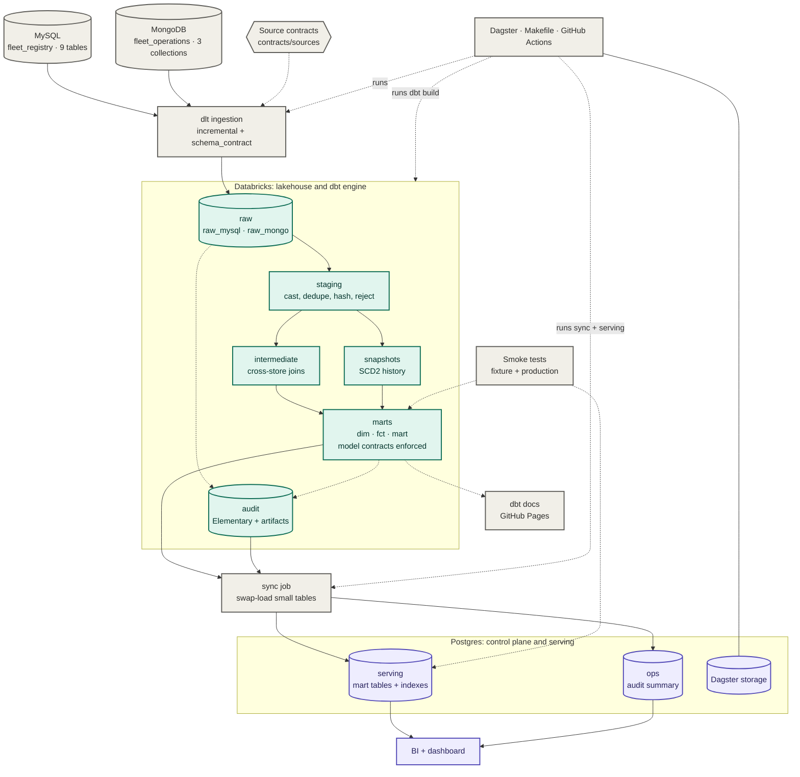
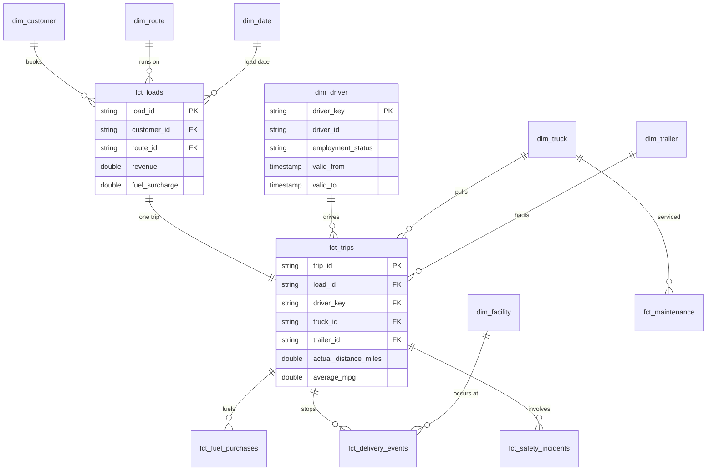
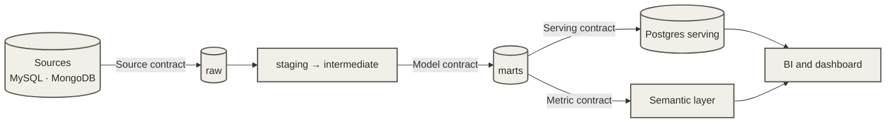
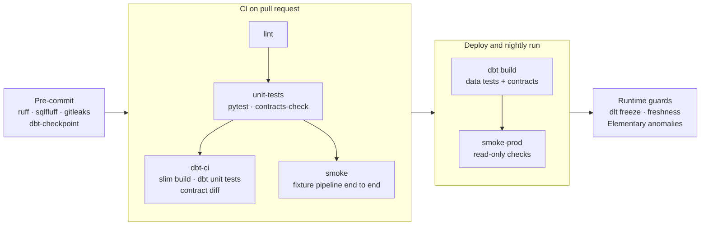
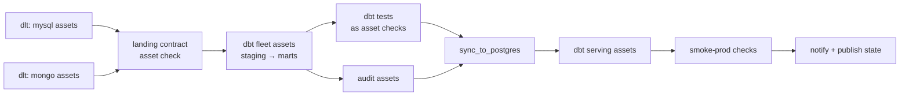

# Architecture

> **Project:** Fleet dbt Lakehouse (`<owner>/fleet-dbt-lakehouse`)
> **Status:** Design baseline · **Version:** 1.1 · **Last updated:** 2026-11-16
> **Companion doc:** [DEPLOYMENT.md](DEPLOYMENT.md): how this architecture is built, shipped and run.

This document explains **what the system is, why it is shaped this way, and how the parts connect**. It is the blueprint; `DEPLOYMENT.md` is the runbook.

---

## Table of contents

1. [Purpose and scope](#1-purpose-and-scope)
2. [Source systems](#2-source-systems)
3. [Design principles](#3-design-principles)
4. [System overview](#4-system-overview)
5. [Platform roles: Databricks vs Postgres](#5-platform-roles-databricks-vs-postgres)
6. [Data layers](#6-data-layers)
7. [Ingestion (dlt)](#7-ingestion-dlt)
8. [Transformation (dbt)](#8-transformation-dbt)
9. [Change data capture and history](#9-change-data-capture-and-history)
10. [Data model (marts)](#10-data-model-marts)
11. [Data contracts](#11-data-contracts)
12. [Testing and data quality](#12-testing-and-data-quality)
13. [Audit and observability](#13-audit-and-observability)
14. [Serving layer and sync](#14-serving-layer-and-sync)
15. [Orchestration (Dagster)](#15-orchestration-dagster)
16. [Environments and schema naming](#16-environments-and-schema-naming)
17. [Security, privacy and access](#17-security-privacy-and-access)
18. [Operational concerns](#18-operational-concerns)
19. [Development workflow and definition of done](#19-development-workflow-and-definition-of-done)
20. [Repository layout](#20-repository-layout)
21. [Key decisions](#21-key-decisions)
22. [Limitations, risks and future work](#22-limitations-risks-and-future-work)

---

## 1. Purpose and scope

The project builds an analytics platform for a trucking fleet. It turns two operational datastores into tested, documented, contract-governed, analysis-ready tables that answer eight business questions:

| # | Use case | Example KPIs |
|---|---|---|
| 1 | Driver performance | On-time rate, MPG, revenue per mile |
| 2 | Route (lane) profitability | Revenue vs fuel and maintenance cost per lane |
| 3 | Fleet utilization | Miles per truck, revenue per asset |
| 4 | Maintenance analysis | Cost per mile, downtime impact |
| 5 | Fuel efficiency | MPG trend, fuel cost per route |
| 6 | Customer analysis | Revenue by customer, service levels |
| 7 | Safety metrics | Incident rate, preventable accidents |
| 8 | Seasonal patterns | Load volume and rate fluctuation by period |

**dbt is the centre of the project.** Everything else (ingestion, orchestration, serving, CI/CD) exists to feed dbt or to ship what dbt produces.

**Out of scope:** real-time streaming, ML models, and an operational (OLTP) application database.

---

## 2. Source systems

Two datastores. Foreign keys are **logical only**: no constraints are declared in MySQL, and MongoDB has none. Cross-store joins therefore happen in the warehouse, in dbt.

### 2.1 MySQL: `fleet_registry` (9 tables)

| Table | Rows | Grain / key | Notes |
|---|---:|---|---|
| `drivers` | 150 | `driver_id` | Status and termination change over time; contains personal data |
| `trucks` | 120 | `truck_id` | `status` changes over time |
| `trailers` | 180 | `trailer_id` | |
| `customers` | 200 | `customer_id` | `account_status` changes over time |
| `facilities` | 50 | `facility_id` | |
| `routes` | 58 | `route_id` | Lane reference data |
| `loads` | 85,410 | `load_id` | FK to customers, routes |
| `trips` | 85,410 | `trip_id` | 1:1 with loads; FK to drivers, trucks, trailers |
| `fuel_purchases` | 196,442 | `fuel_purchase_id` | FK to trips, trucks, drivers; contains fuel card numbers |

### 2.2 MongoDB: `fleet_operations` (3 collections)

| Collection | Docs | Business key | References |
|---|---:|---|---|
| `delivery_events` | 170,820 | `event_id` | loads, trips, facilities |
| `maintenance_records` | 2,920 | `maintenance_id` | trucks |
| `safety_incidents` | 170 | `incident_id` | trips, trucks, drivers; free-text `description` |

### 2.3 Source characteristics that shape the design

| Characteristic | Consequence |
|---|---|
| Every record carries `loaded_at` | Used for source freshness checks and for deduplicating Mongo documents. It is **not** a reliable "changed at" timestamp. |
| Mongo documents are raw CSV rows, **all values are strings** | Staging models cast every column with `try_cast`. Bad values are routed to reject models and counted, not allowed to crash the run (see [section 18.4](#184-error-handling-and-reject-models)). |
| Mongo adds an `_id` (ObjectId) | Dropped in staging; the business key is used instead. |
| No FK constraints, no `updated_at` | `relationships` tests enforce referential integrity. CDC uses lookback windows plus snapshots (see [section 9](#9-change-data-capture-and-history)). |
| Personal and financial identifiers (licence numbers, birth dates, fuel card numbers) | Handled by hashing, masking and exclusion rules (see [section 17.2](#172-sensitive-data-handling)). |
| Totals are modest (about 540k rows) | The choice of Databricks is about architecture, not volume. Full rebuilds are cheap, so correctness is preferred over cleverness. |
| No driver pay, insurance or overhead data | "Profitability" is a **contribution margin** (revenue minus fuel minus allocated maintenance). Rates for any assumed costs live in a versioned seed. |

---

## 3. Design principles

1. **dbt owns all transformation logic.** No stored procedures and no business logic in Python.
2. **One warehouse does the heavy work** (Databricks); the other does a different job (Postgres serves and coordinates). See [section 5](#5-platform-roles-databricks-vs-postgres).
3. **Raw is immutable.** Ingestion only lands data. Nothing is fixed before staging.
4. **Every boundary has a contract.** Source to raw, models to consumers, Databricks to Postgres, and KPI definitions are each governed by a versioned, machine-checked contract (see [section 11](#11-data-contracts)).
5. **Test at the cheapest layer that can catch the bug.** Static checks, then unit tests, then data tests, then smoke tests (see [section 12](#12-testing-and-data-quality)).
6. **Every step is safe to re-run.** Idempotency is a requirement, and a smoke test proves it.
7. **Environments are isolated by schema, not by hope.** Dev and CI never write to production schemas.
8. **Every command is a `make` target.** The same targets run on a laptop, in CI and in the container.
9. **Audit is derived, not hand-built.** It is assembled from dlt and dbt metadata.
10. **Sensitive data is minimised by default.** Identifiers are hashed or dropped before they reach marts or Postgres.

---

## 4. System overview



**Reading the diagram**

- Solid arrows are data movement. Dotted arrows are metadata, control, validation or documentation flow.
- Colour: teal = Databricks, purple = Postgres and consumers, grey = sources and support.

### 4.1 End-to-end run, step by step

| Step | Component | What happens |
|---:|---|---|
| 1 | Dagster | The daily schedule (02:00 IST) launches the job. |
| 2 | dlt | Extracts MySQL and MongoDB incrementally. The **source contract** is enforced as a dlt `schema_contract`; a drifted schema stops the load. Rows land in Databricks `raw`. |
| 3 | dbt (`fleet`) | Checks source freshness, then builds staging, snapshots, intermediate and marts. Data tests run in DAG order; **model contracts** are enforced at build time. |
| 4 | dbt + Elementary | Writes run results, test failures and anomaly results to the `audit` schema. |
| 5 | Sync job | Copies tables tagged `serve` and the audit summary from Databricks to Postgres using a transactional swap. |
| 6 | dbt (`serving`) | Builds indexes and dashboard-shaped views in Postgres and tests the **serving contract** and row-count parity. |
| 7 | Smoke tests | A read-only production smoke suite confirms the platform is alive and sane (see [section 12.7](#127-smoke-tests)). |
| 8 | Dagster | Records the run, fires failure alerts if needed, and writes the manifest used by slim CI. |
| 9 | CI/CD (on code change only) | Rebuilds docs and publishes them to GitHub Pages. |

---

## 5. Platform roles: Databricks vs Postgres

The two platforms have **different jobs**. They are not copies of each other.

| | Databricks | Postgres |
|---|---|---|
| **Role** | Lakehouse and transformation engine | Control plane and serving layer |
| **Holds** | `raw`, `staging`, `intermediate`, `marts`, `snapshots`, `audit` | Dagster run storage, `serving` tables, `ops` audit summary |
| **dbt adapter** | `dbt-databricks`, project `dbt/fleet` | `dbt-postgres`, project `dbt/serving` |
| **Workload** | Heavy joins, incrementals, history | Fast, small, indexed reads |
| **Storage format** | Delta tables in Unity Catalog | Regular heap tables |
| **Consumers** | dbt, analysts doing ad-hoc work | BI tool and dashboard |
| **Why** | Elastic compute, Delta merge, Unity Catalog governance | Cheap, always-on, low-latency, ideal for orchestrator metadata |

**Why not split transformation layers across both?** dbt cannot `ref()` across two adapters. A mid-pipeline handoff would break lineage, tests and docs. The only handoff is therefore **after** marts are complete and tested, through an explicit sync step.

---

## 6. Data layers

| Layer | Platform | Schema | Built by | Materialization | Purpose |
|---|---|---|---|---|---|
| Raw | Databricks | `raw` (tables prefixed `mysql__`, `mongo__`) | dlt | Delta table | Landed as-is, plus metadata columns |
| Staging | Databricks | `staging` | dbt | view | One model per source table: rename, cast, dedupe, hash sensitive columns |
| Rejects | Databricks | `staging` (`rej_*`) | dbt | table | Rows that failed casting, with a reason |
| Intermediate | Databricks | `intermediate` | dbt | ephemeral or view | Joins and business logic; not for consumers |
| Marts | Databricks | `marts` | dbt | table or incremental | Dimensions, facts and business marts, under contract |
| Snapshots | Databricks | `snapshots` | dbt | Delta table | SCD2 history of slowly changing entities |
| Audit | Databricks | `audit` | dbt, Elementary | table, view | Run, test, contract and reconciliation history |
| Serving | Postgres | `serving` | sync + dbt | table, view | Dashboard-ready copy of tagged marts |
| Ops | Postgres | `ops` | sync | table | Latest pipeline status for dashboards |

### 6.1 Naming conventions

| Object | Pattern | Example |
|---|---|---|
| Source tables | `<system>__<entity>` | `mysql__loads`, `mongo__delivery_events` |
| Staging models | `stg_<system>__<entity>` | `stg_mysql__loads` |
| Reject models | `rej_<system>__<entity>` | `rej_mongo__delivery_events` |
| Intermediate models | `int_<verb>_<entity>` | `int_trips_with_delivery_events` |
| Dimensions | `dim_<entity>` | `dim_driver` |
| Facts | `fct_<event>` | `fct_trips` |
| Business marts | `mart_<topic>` | `mart_driver_performance` |
| Snapshots | `snap_<entity>` | `snap_drivers` |
| Audit models | `audit_<topic>` | `audit_reconciliation` |
| Contract files | `<system>__<entity>.yml` | `mysql__loads.yml` |
| Primary keys | `<entity>_id` (natural) or `<entity>_key` (surrogate) | `driver_id`, `driver_key` |
| Booleans | `is_<state>` | `is_on_time` |
| Timestamps | `<event>_at`, dates `<event>_date` | `dispatched_at`, `load_date` |
| Test names (dbt unit) | `test_<model>_<behaviour>` | `test_mart_driver_performance_on_time_rate` |

---

## 7. Ingestion (dlt)

dlt moves data from the two sources into Databricks `raw`. It does not transform.

### 7.1 Responsibilities

- Connect to MySQL (SQL source) and MongoDB (document source) with **read-only** credentials.
- Land each table or collection as-is, preserving source column names.
- Add metadata columns: `_ingested_at`, `_dlt_load_id`.
- Enforce the **source contract** through dlt's `schema_contract` (see [section 11.3](#113-how-source-contracts-are-enforced)).
- Track load history in its own `_dlt_loads` table.
- Handle incremental extraction state.

### 7.2 Extraction strategy per table

| Tables | Mode | Reason |
|---|---|---|
| `drivers`, `trucks`, `trailers`, `customers`, `facilities`, `routes` | Full replace each run | Small and without a reliable change cursor. Snapshots capture history downstream. |
| `loads`, `trips` | Incremental on the business date with a lookback window | Statuses change after the row is created. |
| `fuel_purchases` | Incremental on `purchase_date` | Mostly immutable. |
| `delivery_events` | Incremental on `scheduled_datetime` with lookback | `actual_datetime` and `detention_minutes` arrive later. |
| `maintenance_records`, `safety_incidents` | Full replace | Small; claim and cost values are updated over time. |

Raw tables are **merge landed**: dlt uses a merge write disposition on the primary or business key, so each key has one current row in raw, and history is derived by dbt snapshots. Mongo values arrive as strings and are kept as strings.

### 7.3 Source connectivity modes

| Mode | `SOURCE_MODE` | Reads from | Used for |
|---|---|---|---|
| `live` | `live` | The real MySQL and MongoDB | Local dev with Docker sources, or cloud-hosted sources |
| `csv` | `csv` | Full gzipped CSV snapshots under `data/raw/` | Public deployments and demos with no source access |
| `fixture` | `fixture` | A tiny curated sample under `tests/fixtures/` | CI smoke tests (see [section 12.8](#128-fixtures-and-golden-data)) |

See [DEPLOYMENT.md](DEPLOYMENT.md#10-source-connectivity) for why connectivity matters on GitHub-hosted runners.

---

## 8. Transformation (dbt)

### 8.1 Two dbt projects

| Project | Path | Adapter | Scope |
|---|---|---|---|
| `fleet` | `dbt/fleet` | `dbt-databricks` | All transformation, tests, snapshots, audit |
| `fleet_serving` | `dbt/serving` | `dbt-postgres` | Indexes, serving views, parity tests |

A shared `dbt/profiles.yml` defines both profiles, reading everything from environment variables.

### 8.2 `fleet` project structure

```text
dbt/fleet/
├── dbt_project.yml
├── packages.yml
├── models/
│   ├── staging/
│   │   ├── mysql/    _mysql__sources.yml, _mysql__models.yml, stg_mysql__*.sql
│   │   └── mongo/    _mongo__sources.yml, _mongo__models.yml, stg_mongo__*.sql, rej_mongo__*.sql
│   ├── intermediate/ int_*.sql
│   ├── marts/
│   │   ├── core/     dim_*.sql, fct_*.sql, _core__models.yml (contracts)
│   │   └── business/ mart_*.sql, _business__models.yml (contracts)
│   ├── audit/        audit_*.sql
│   └── semantic/     semantic models and metrics
├── snapshots/        snap_drivers.sql, snap_trucks.sql, snap_customers.sql
├── seeds/            cost_assumptions.csv, expected_row_counts.csv, plausible_ranges.csv
├── macros/           generate_schema_name, pii_hash, lookback helpers, drop_ci_schemas
├── tests/            singular tests (cross-store reconciliation, flag consistency)
└── analyses/
```

### 8.3 Packages

| Package | Why |
|---|---|
| `dbt_utils` | Surrogate keys, generic tests, date spine |
| `dbt_expectations` | Distribution and range tests |
| `elementary` | Run and test result tables, anomaly and schema-change tests, report |
| `dbt_project_evaluator` | Checks the project against dbt conventions and reports test and documentation coverage |
| `codegen` (dev only) | Generates source and model YAML |

### 8.4 Layer rules

**Staging**
- One model per source table; only rename, cast, dedupe, hash sensitive columns and light cleaning.
- No joins. No business logic.
- Mongo models cast every string column with `try_cast`, normalise flags (`'true'`, `'1'`, `'yes'` become boolean) and keep the latest document per business key using `loaded_at`. Rows that fail a cast go to the matching `rej_` model.
- Always selects from `{{ source() }}`, never from a hard-coded table name.

**Intermediate**
- Joins and reusable business logic. The key cross-store join is `trips` (MySQL) with `delivery_events` (MongoDB).
- Materialized as ephemeral or view. Consumers never query this layer.

**Marts**
- Dimensions and facts in `marts/core/`; business-facing aggregates in `marts/business/`.
- **Model contracts are enforced** on every mart (see [section 11.4](#114-model-contracts-dbt)).
- Marts tagged `serve` (via `meta`) are synced to Postgres.

### 8.5 Materialization defaults (`dbt_project.yml`)

```yaml
models:
  fleet:
    staging:
      +schema: staging
      +materialized: view
      +group: ingestion
      +access: protected
    intermediate:
      +schema: intermediate
      +materialized: ephemeral
      +group: analytics
      +access: private
    marts:
      +schema: marts
      +materialized: table
      +group: analytics
      +access: public
      +contract:
        enforced: true
    audit:
      +schema: audit
      +materialized: table

snapshots:
  fleet:
    +target_schema: snapshots
```

Large facts (`fct_trips`, `fct_fuel_purchases`, `fct_delivery_events`) override to `incremental` with `incremental_strategy: merge`, a `unique_key`, and `on_schema_change: fail` (required to keep a contract meaningful on an incremental model).

### 8.6 Dialect note

Because the main project targets only Databricks, it uses native Databricks SQL (for example `try_cast`) directly. The Postgres `serving` project deliberately contains almost no logic (indexes, thin views, parity tests), so there is no cross-dialect portability problem to solve.

### 8.7 Documentation and exposures

- Every model and every mart column has a description. `dbt-checkpoint` and `dbt_project_evaluator` enforce this in CI.
- Dashboards are declared as **exposures** so lineage runs from source to dashboard.
- KPIs (on-time rate, MPG, revenue per mile) are defined once in the **semantic layer** so BI tools and ad-hoc queries share definitions.
- `dbt docs` is published to GitHub Pages (see [DEPLOYMENT.md](DEPLOYMENT.md#8-github-pages-documentation-site)).

---

## 9. Change data capture and history

The sources have no reliable `updated_at`, and the data is largely static. The CDC approach is therefore **watermark plus lookback plus snapshots**, designed to be honest about what it can and cannot detect.

### 9.1 Strategy by table

| Table(s) | Strategy | Detail |
|---|---|---|
| `drivers`, `trucks`, `customers` | **Snapshot** (`check` strategy) | SCD2 history for `employment_status`, `termination_date`, `status`, `account_status` |
| `trailers`, `facilities`, `routes` | Full refresh, no history | Reference data with negligible change; promote to snapshots if needed |
| `loads`, `trips` | **Incremental merge** with lookback | `load_status` and `trip_status` change after creation |
| `fuel_purchases` | Incremental merge | Effectively immutable |
| `delivery_events` | Incremental merge on `event_id` | Late-arriving actual times |
| `maintenance_records`, `safety_incidents` | Incremental merge or full refresh | Cost and claim values revised later |

### 9.2 Incremental pattern

```sql
{{ config(
    materialized='incremental',
    incremental_strategy='merge',
    unique_key='load_id',
    on_schema_change='fail'
) }}

select * from {{ ref('stg_mysql__loads') }}

  
where load_date between '{{ var("backfill_start") }}' and '{{ var("backfill_end") }}'
  
where load_date >= (
    select date_sub(max(load_date), {{ var('incremental_lookback_days', 14) }})
    from {{ this }}
)
  

```

The lookback window (default 14 days) re-processes recent rows so late status changes are picked up. The `backfill_start` and `backfill_end` variables replace the lookback for targeted historical corrections (see [section 18.3](#183-backfills)). Because the model merges on `unique_key`, both paths are idempotent.

### 9.3 Known limits

| Limit | Mitigation |
|---|---|
| Hard deletes are invisible to watermarks | Small dimensions compare keys on each full load and set `is_deleted`. Large facts are append-and-correct only. |
| Changes older than the lookback are missed | Periodic full refresh (weekly job) plus reconciliation counts in `audit_reconciliation` |
| Static source data produces no changes | A **change simulator** (`simulator/`) updates statuses, revises amounts and inserts new loads so CDC has something to detect. It is seeded, so runs are reproducible. |

### 9.4 Stretch: log-based CDC

Debezium (MySQL binlog, MongoDB change streams) would give real insert, update and delete events, including deletes. It needs Kafka or an equivalent and is deliberately out of the baseline scope.

---

## 10. Data model (marts)

### 10.1 Entity relationships



`dim_driver` (and `dim_truck`, `dim_customer`) are built from snapshots, so facts join to the version of the dimension that was valid at the event date. Column types shown are illustrative; the contracts are the source of truth.

### 10.2 Core models

| Model | Grain | Source |
|---|---|---|
| `dim_driver`, `dim_truck`, `dim_customer` | One row per entity version (SCD2) | Snapshots |
| `dim_trailer`, `dim_facility`, `dim_route` | One row per entity | Staging |
| `dim_date` | One row per calendar day | Date spine |
| `fct_loads` | One row per load | `stg_mysql__loads` |
| `fct_trips` | One row per trip (1:1 with load) | `stg_mysql__trips` + intermediate |
| `fct_fuel_purchases` | One row per purchase | `stg_mysql__fuel_purchases` |
| `fct_delivery_events` | One row per delivery event | `stg_mongo__delivery_events` |
| `fct_maintenance` | One row per maintenance record | `stg_mongo__maintenance_records` |
| `fct_safety_incidents` | One row per incident | `stg_mongo__safety_incidents` |

### 10.3 Business marts

| Mart | Use case | Notes |
|---|---|---|
| `mart_driver_performance` | 1 | On-time rate joins MySQL trips to Mongo delivery events |
| `mart_lane_profitability` | 2 | Contribution margin per lane: revenue minus fuel minus allocated maintenance; assumptions in `cost_assumptions` seed |
| `mart_fleet_utilization` | 3 | Miles and revenue per truck and per trailer |
| `mart_maintenance_cost_per_mile` | 4 | Maintenance cost over trip miles; downtime impact |
| `mart_fuel_efficiency` | 5 | MPG trend, fuel cost per route |
| `mart_customer_service_levels` | 6 | Revenue by customer, on-time and detention metrics |
| `mart_safety_metrics` | 7 | Incident rate per million miles, preventable share |
| `mart_seasonality` | 8 | Load volume and rate per mile by week, month and quarter |

---

## 11. Data contracts

A **data contract** here is a versioned, machine-checked agreement about the shape, meaning, quality and freshness of data at a boundary. A change that breaks a contract fails a check before it reaches a consumer.

### 11.1 Contract boundaries



| Boundary | Producer | Consumer | Contract | Enforced by |
|---|---|---|---|---|
| Source to raw | MySQL and MongoDB owners | dlt, dbt staging | **Source contract** (`contracts/sources/*.yml`) | dlt `schema_contract`, `make contracts-check`, dbt source tests and freshness |
| Models to consumers | dbt marts | BI, analysts, the sync job | **Model contract** | dbt `contract.enforced`, constraints, `access`, versions |
| Databricks to Postgres | Sync job | Dashboard | **Serving contract** | `dbt/serving` tests, schema parity check |
| KPI meaning | Semantic layer | BI, ad-hoc queries | **Metric contract** | Semantic layer definitions, dbt unit tests |

### 11.2 Source contract format

One YAML file per source table or collection, under `contracts/sources/`. It is the single source of truth for what ingestion may deliver.

```yaml
# contracts/sources/mysql__loads.yml   (types below are illustrative; take real ones from the source DDL)
contract_version: 1.0.0
source: mysql.fleet_registry.loads
landing_table: raw.mysql__loads
owner: fleet-data-eng
primary_key: [load_id]
extraction:
  mode: incremental
  cursor: load_date
  lookback_days: 14
columns:
  - { name: load_id,        type: bigint,        nullable: false }
  - { name: customer_id,    type: bigint,        nullable: false, references: customers.customer_id }
  - { name: route_id,       type: bigint,        nullable: false, references: routes.route_id }
  - { name: load_date,      type: date,          nullable: false }
  - { name: revenue,        type: decimal(12,2), nullable: false, min: 0 }
  - { name: load_status,    type: string,        nullable: false }
  - { name: loaded_at,      type: timestamp,     nullable: false }
quality:
  row_count: { baseline: 85410, tolerance_pct: 5 }
freshness:
  loaded_at_field: loaded_at
  warn_after_hours: 26
  error_after_hours: 48
change_policy:
  additive_column: minor_bump      # allowed after the contract is updated
  removed_or_retyped: major_bump   # breaking
```

Mongo contracts add the staging cast, because every raw value is a string:

```yaml
# contracts/sources/mongo__delivery_events.yml (excerpt)
contract_version: 1.0.0
source: mongodb.fleet_operations.delivery_events
primary_key: [event_id]
columns:
  - { name: event_id,           raw_type: string, staged_type: string,    nullable: false }
  - { name: scheduled_datetime, raw_type: string, staged_type: timestamp, nullable: false, cast: try_cast }
  - { name: actual_datetime,    raw_type: string, staged_type: timestamp, nullable: true,  cast: try_cast }
  - { name: detention_minutes,  raw_type: string, staged_type: int,       nullable: true,  cast: try_cast, min: 0 }
  - { name: on_time_flag,       raw_type: string, staged_type: boolean,   nullable: true,  cast: flag }
quality:
  max_cast_failure_pct: 0.1
```

### 11.3 How source contracts are enforced

| Layer | Mechanism | Failure behaviour |
|---|---|---|
| Ingestion | dlt `schema_contract` set to `freeze` for columns and data types in prod (`evolve` in dev) | The load raises a validation error and nothing is written. Add the column to the contract first. |
| Consistency | `make contracts-check` compares contract files, dlt configuration and dbt source YAML | CI fails on drift (a column in one place but not the others) |
| Landing | A Dagster asset check compares the landed raw schema with the contract | Run fails before dbt starts |
| dbt sources | Source tests (`not_null`, `unique`, `accepted_values`) and `loaded_at` freshness derived from the contract | Error or warn per severity |
| Volume | Row-count baseline and tolerance, mirrored in the `expected_row_counts` seed | `audit_reconciliation` and smoke tests fail |

```python
pipeline.run(
    source,
    schema_contract={"tables": "evolve", "columns": "freeze", "data_type": "freeze"},
)
```

New tables are allowed to evolve (a new source table is not a breaking change), but any unexpected column or type change is frozen out until the contract is updated.

### 11.4 Model contracts (dbt)

Every mart declares its columns, types and constraints. With `contract.enforced: true`, dbt checks the returned columns and types against the YAML at build time and fails the model on mismatch.

```yaml
models:
  - name: fct_trips
    description: One row per trip. Grain is trip_id; one trip per load.
    config:
      contract: { enforced: true }
      access: public
      group: analytics
      on_schema_change: fail
      meta:
        owner: fleet-data-eng
        tier: critical
        serve: true
        contains_pii: false
    constraints:
      - type: primary_key
        columns: [trip_id]
    columns:
      - name: trip_id
        data_type: string
        constraints: [{ type: not_null }]
        data_tests: [unique, not_null]
      - name: load_id
        data_type: string
        constraints: [{ type: not_null }]
        data_tests:
          - relationships: { to: ref('fct_loads'), field: load_id }
      - name: actual_distance_miles
        data_type: double
      - name: average_mpg
        data_type: double
```

Points to remember:

- On Databricks, `not_null` and `check` constraints are enforced by Delta. **Primary and foreign key constraints are informational** in Unity Catalog, so uniqueness and referential integrity are still enforced by dbt tests. Confirm current behaviour in the dbt-databricks documentation.
- Types in the YAML must match the SQL exactly. Cast explicitly in the model.
- Constraint declarations belong in the same PR as the model change.

### 11.5 Access levels and groups

| Level | Meaning in dbt | Used for |
|---|---|---|
| `private` | Referenceable only inside the same group | Intermediate models (group `analytics`) |
| `protected` (default) | Referenceable by any model in the project | Staging models (group `ingestion`) |
| `public` | Referenceable across groups (and, in future, projects) | Marts: the supported interface of the project |

### 11.6 Versioning a breaking change

A breaking change to a mart ships as a **new model version**, with the old version kept until a deprecation date.

```yaml
models:
  - name: mart_driver_performance
    latest_version: 2
    config: { contract: { enforced: true } }
    columns:
      - name: driver_key
        data_type: string
      - name: avg_mpg
        data_type: double
    versions:
      - v: 1
        deprecation_date: 2027-03-31
      - v: 2
        columns:
          - include: all
            exclude: [avg_mpg]
          - name: avg_mpg_loaded
            data_type: double
```

Consumers keep working on `v1` until the deprecation date; dbt warns when a deprecated version is referenced.

### 11.7 Change classification

| Change | Breaking? | Required action |
|---|---|---|
| Add a nullable column to a mart or source | No | Update the contract and YAML, minor version bump |
| Add a new mart or source table | No | Add contract and YAML |
| Loosen an accepted-values list or widen a range | No | Patch bump, document in the changelog |
| Remove or rename a column | **Yes** | New model version, deprecation date, `contract-change` PR label |
| Change a column's data type | **Yes** | New model version, `contract-change` label |
| Change a KPI's formula (metric contract) | **Yes** | New metric version, changelog, notify consumers |
| Tighten an accepted-values list | Possibly | Treat as breaking unless the removed values are provably unused |

### 11.8 Contract lifecycle

1. **Propose:** open a PR that changes the contract file and the model or source YAML together.
2. **Detect:** CI runs `make contracts-check` and lists models whose contract changed (`state:modified.contract` against the last production manifest). A changed contract requires the `contract-change` label.
3. **Review:** a reviewer confirms the change class and, for breaking changes, the new version and deprecation date.
4. **Release:** a breaking change increments the MAJOR version (see [DEPLOYMENT.md](DEPLOYMENT.md#11-releases-versioning-and-rollback)).
5. **Deprecate:** the old model version stays until its `deprecation_date`, then is removed in a later release.

### 11.9 Serving and metric contracts

- **Serving contract:** the Postgres `serving` tables must have the same column names and compatible types as the Databricks marts tagged `serve`. The sync job fails on a column mismatch, and `dbt/serving` tests row counts and key uniqueness.
- **Metric contract:** KPIs are defined once in the semantic layer. A metric change is treated as a breaking change (see the table above) and is covered by dbt unit tests.

---

## 12. Testing and data quality

Testing is layered so each bug is caught by the **cheapest** test that can see it.

### 12.1 Test types

| Type | Question it answers | Tools | Needs a warehouse? | Real data? | Runs in |
|---|---|---|---|---|---|
| Static | Is the code well formed and compliant? | ruff, sqlfluff, yamllint, `dbt-checkpoint`, gitleaks, `dbt parse`, `dbt_project_evaluator` | No (sqlfluff's dbt templater needs a profile) | No | Pre-commit, CI `lint` |
| Python unit | Does my Python logic behave? | pytest | No | No | CI `unit-tests` |
| dbt unit | Does my SQL logic give the right answer on known inputs? | dbt unit tests | Yes (compute only) | Mocked in YAML | CI `dbt-ci`, local |
| Contract | Has any boundary changed shape? | dbt contracts, `make contracts-check`, dlt `schema_contract` | Partly | No (checks) / Yes (runtime) | CI, ingestion, build |
| Data tests | Is the real data valid? | dbt generic and singular tests, `dbt_utils`, `dbt_expectations` | Yes | Yes | Every `dbt build` |
| Smoke (pre-merge) | Does the whole pipeline work end to end on tiny data? | pytest and fixtures | Yes | Fixtures | CI `smoke` |
| Smoke (post-deploy) | Is production alive and sane right now? | pytest, read-only | Yes | Production | End of deploy, nightly |
| Reconciliation | Do counts line up from source to mart? | `audit_reconciliation` | Yes | Yes | Every run |
| Anomaly | Is volume or freshness unusual? | Elementary | Yes | Yes | Every run |

### 12.2 Where each test runs



### 12.3 Static checks

| Check | Tool | Notes |
|---|---|---|
| Python style and bugs | ruff | Part of `make lint-fast` |
| SQL style | sqlfluff with the dbt templater, dialect `databricks` | Needs a valid profile, so it runs in `dbt-ci` |
| YAML style | yamllint | |
| Secrets | gitleaks | Pre-commit and CI |
| dbt hygiene | `dbt-checkpoint` | Every model has a description, owner meta and tests |
| Project structure | `dbt_project_evaluator` | Naming, DAG and coverage rules |
| Project validity | `dbt parse` | Catches broken refs and Jinja without building |

### 12.4 Python unit and integration tests

The Python code is thin but important. Tests are marked so each tier can run on its own.

```toml
# pyproject.toml
[tool.pytest.ini_options]
addopts = "-ra --strict-markers"
markers = [
  "unit: fast, no network",
  "integration: needs the Postgres service container",
  "contract: validates contracts against the dbt manifest",
  "smoke: end-to-end on fixtures (needs warehouse and Postgres)",
  "smoke_prod: read-only checks against production",
]
```

| Package | What is tested |
|---|---|
| `ingestion` | Pipelines build the right `schema_contract`; incremental cursor and lookback are applied; `SOURCE_MODE` selects the right reader |
| `sync` | Swap SQL is generated in the right order (new table, rename old to `__prev`, rename new); a count mismatch aborts and leaves the old table in place; column mismatch is rejected |
| `simulator` | Output is deterministic for a given seed; it only touches allowed tables |
| `orchestration` | Definitions load without error; schedule uses cron `0 2 * * *` in `Asia/Kolkata`; asset keys match the dbt manifest; prod jobs exclude dbt unit tests |
| `scripts` and contracts | The contract parser accepts valid files and rejects malformed ones; drift between contracts, dlt config and dbt sources is detected |

A coverage gate (default 80 percent, configurable through `COV_MIN`) applies to `ingestion`, `sync`, `orchestration`, `simulator` and `scripts`.

### 12.5 dbt unit tests

dbt unit tests validate SQL logic against **mocked inputs and expected outputs** written in YAML. They need a warehouse connection to compute, but no real data. In `dbt build`, a model's unit tests run before the model is built, so wrong logic blocks the build.

What to cover:

| Logic | Test idea |
|---|---|
| On-time rate | Two events for one driver, one on time, gives 0.5 |
| MPG and revenue per mile | Zero gallons or zero miles gives `NULL`, not an error |
| Mongo dedupe | Two documents with the same `event_id` keep the one with the latest `loaded_at` |
| Flag normalisation | `'true'`, `'1'`, `'yes'` become `true`; other values become `NULL` |
| SCD2 join | A trip joins to the driver version valid on its dispatch date |
| Lookback filter | An incremental run reprocesses rows inside the window only |
| Contribution margin | Revenue minus fuel minus allocated maintenance for a known lane |
| Seasonality buckets | Dates fall in the right week, month and quarter |

```yaml
unit_tests:
  - name: test_mart_driver_performance_on_time_rate_and_mpg
    model: mart_driver_performance
    given:
      - input: ref('fct_trips')
        rows:
          - { trip_id: T1, driver_key: D1, actual_distance_miles: 100, fuel_gallons_used: 20 }
      - input: ref('fct_delivery_events')
        rows:
          - { event_id: E1, trip_id: T1, is_on_time: true }
          - { event_id: E2, trip_id: T1, is_on_time: false }
    expect:
      rows:
        - { driver_key: D1, on_time_rate: 0.5, avg_mpg: 5.0 }

  - name: test_fct_loads_lookback_reprocesses_recent_rows_only
    model: fct_loads
    overrides:
      macros:
        is_incremental: true
    given:
      - input: ref('stg_mysql__loads')
        rows:
          - { load_id: L1, load_date: 2026-01-01 }
          - { load_id: L2, load_date: 2026-11-10 }
      - input: this
        rows:
          - { load_id: L0, load_date: 2026-11-12 }
    expect:
      rows:
        - { load_id: L2, load_date: 2026-11-10 }
```

Conventions: one behaviour per test, tiny inputs, list only the columns that matter, name tests `test_<model>_<behaviour>`. Unit tests run in CI and locally, and are **excluded from production builds** (`--exclude-resource-type unit_test`) because their inputs do not change between runs.

### 12.6 Data tests and quality gates by layer

Data tests run **inside `dbt build`** in DAG order. A failing test on an upstream model stops downstream models from building.

| Layer | Checks | Severity |
|---|---|---|
| Sources | Freshness on `loaded_at` (warn at 26h, error at 48h); `not_null` and `unique` on keys | error |
| Staging | `unique` and `not_null` on primary keys; `accepted_values` on statuses and types; `relationships` for every logical FK; cast-failure rate from `rej_` models | error for keys, warn for soft rules |
| Intermediate | Row-count parity (a load has exactly one trip); join fan-out checks | error |
| Marts | Contracts enforced; `dbt_utils` and `dbt_expectations` range and distribution tests; **flag consistency** (the provided `on_time_flag` agrees with `actual <= scheduled`) | error |
| Audit | Reconciliation against the `expected_row_counts` seed | error |
| Serving | Row-count parity and key uniqueness in Postgres | error |

Soft rules use thresholds instead of all-or-nothing failure, and failing rows are stored for inspection:

```yaml
- name: detention_minutes
  data_tests:
    - not_null:
        config:
          severity: error
          warn_if: ">0"
          error_if: ">50"
          store_failures: true
```

### 12.7 Smoke tests

Smoke tests answer "does it basically work?" quickly. There are two tiers.

**Pre-merge smoke (`make smoke-ci`):** runs in CI on tiny fixture data, in its own schemas (`ci_pr_<n>_smoke_*`).

| # | Check |
|---:|---|
| 1 | Fixture ingest lands every source table in the smoke raw schema, with row counts matching `tests/fixtures/expected.yml` |
| 2 | A full `dbt build` (no defer) succeeds, including contracts and data tests |
| 3 | Every mart is non-empty and key counts match the expected values |
| 4 | **Golden KPIs** equal hand-computed values (for example, one driver's on-time rate is exactly 0.75) |
| 5 | Every fixture trip has at least one delivery event (cross-store join sanity) |
| 6 | The sync job copies tagged marts to Postgres and parity tests pass |
| 7 | **Idempotency:** a second `dbt build` leaves row counts unchanged |
| 8 | **CDC:** after the seeded simulator runs, changed statuses appear in `fct_loads` and a changed driver gains a new snapshot version |

**Post-deploy smoke (`make smoke-prod`):** read-only checks against production at the end of every deploy and nightly run. It never writes, and finishes in about a minute or two.

| # | Check |
|---:|---|
| 1 | Connectivity: `select 1` on Databricks and Postgres |
| 2 | Every contract-governed mart exists with exactly the contract's columns and types |
| 3 | Row counts are within the contract baseline and tolerance |
| 4 | Freshness: latest `_ingested_at` is inside the SLA |
| 5 | The latest `audit_dbt_runs` row shows success and zero failed tests |
| 6 | Serving parity: counts match for synced tables; `ops.pipeline_status` is recent |
| 7 | KPI sanity: values lie inside `plausible_ranges` (for example on-time rate between 0 and 1) |
| 8 | The docs site responds with HTTP 200 (a workflow step, not a pytest) |

```python
# tests/smoke_prod/test_marts.py
import pytest

pytestmark = pytest.mark.smoke_prod


def test_marts_are_not_empty(dbx, marts_under_contract):
    for table in marts_under_contract:
        assert dbx.scalar(f"select count(*) from {table}") > 0, f"{table} is empty"


def test_mart_columns_match_contract(dbx, contracts):
    for table, expected in contracts.items():
        actual = dbx.columns(table)           # name -> type from information_schema
        assert actual == expected, f"{table} drifted from its contract"
```

### 12.8 Fixtures and golden data

`tests/fixtures/` holds a small, deterministic sample that keeps referential integrity (for example 200 loads and every trip, fuel purchase, event and dimension row they reference). `make fixtures` regenerates it from `data/raw/` with a fixed seed. `tests/fixtures/expected.yml` holds the golden values.

The sample deliberately includes **edge cases**:

- A late-arriving delivery event.
- A Mongo row with an uncastable timestamp (goes to a `rej_` model).
- A duplicate Mongo document (dedupe keeps the latest `loaded_at`).
- A trip with zero gallons used (divide-by-zero guard).
- A driver who is terminated (SCD2 history).
- A load with an unusually long detention.
- A null `detention_minutes`.

Golden values change only when business logic is changed on purpose, in a reviewed PR.

### 12.9 Coverage targets and reporting

| Measure | Target | Source |
|---|---|---|
| Primary keys with `unique` and `not_null` tests | 100% | `dbt_project_evaluator` |
| Models with descriptions | 100% | `dbt-checkpoint` |
| Marts under enforced contract | 100% | `make contracts-check` |
| Python coverage on the five packages | 80% or more | pytest-cov gate |
| Reports | JUnit XML per CI job, Elementary report, dbt docs | Actions artifacts and Pages |

---

## 13. Audit and observability

Most audit data already exists in the tools used. The project assembles it instead of building it by hand.

| Source | What it records | Where it lands |
|---|---|---|
| dlt `_dlt_loads` | Load id, status and time per ingestion run | `raw` (read by `audit_ingestion_runs`) |
| dbt artifacts via Elementary | Per-model run time, status and rows | `audit` (Elementary tables) |
| `dbt test --store-failures` | The failing rows of each test | `audit` failure schema |
| Row-level lineage columns | `_ingested_at`, dbt `invocation_id`, run start time | Columns in staging and marts |
| Reconciliation | Source vs raw vs mart counts against a seed | `audit_reconciliation` |
| Contract checks | Drift results and landing-schema checks | `audit_contract_checks` |
| Reject models | Rows that failed a cast and why | `rej_*` models, counted in `audit_reject_summary` |

### 13.1 Audit models

| Model | Content |
|---|---|
| `audit_ingestion_runs` | One row per dlt load with status and duration |
| `audit_dbt_runs` | One row per dbt invocation with model counts and failures |
| `audit_test_failures` | View over stored failing rows |
| `audit_reconciliation` | Expected vs actual row counts per table and layer |
| `audit_contract_checks` | Latest contract check outcome per source and mart |
| `audit_reject_summary` | Reject counts and rates per source table |
| `audit_pipeline_status` | Latest status per stage; synced to Postgres `ops` |

### 13.2 Observability extras

- Elementary anomaly tests on volume and freshness for the large tables, and `schema_changes` tests as a second line of defence for contracts.
- An Elementary report is generated in CI/CD and may be published alongside the docs.
- Dagster shows asset lineage, run history and failures; a failure sensor posts alerts.

---

## 14. Serving layer and sync

### 14.1 What gets synced

- Marts whose `meta` contains `serve: true`.
- The `audit_pipeline_status` summary (to `ops`).
- Full raw, staging and snapshots **never** leave Databricks. Sensitive columns are not part of any synced mart (see [section 17.2](#172-sensitive-data-handling)).

### 14.2 Sync algorithm

For each table:

1. Validate the column names and types against the **serving contract**; abort on mismatch.
2. Read from Databricks with the SQL connector into Arrow batches.
3. Create `serving.<table>__new` in Postgres and bulk-load it with `COPY`.
4. In **one transaction**: rename `<table>` to `<table>__prev`, rename `<table>__new` to `<table>`, and recreate indexes and grants.
5. Compare row counts with Databricks; fail the run on mismatch.
6. Drop the previous `__prev` table at the *next* sync, so one version is always available for rollback.

Readers never see a partial table because the swap is atomic.

### 14.3 What the `serving` dbt project adds

- Post-hook indexes on filter columns (dates, driver, customer, route).
- Thin views shaped for dashboards.
- Parity and freshness tests.

### 14.4 Why Postgres and not Databricks SQL for dashboards

Dashboard queries are small and frequent. Serving them from an always-on Postgres avoids running a Databricks SQL warehouse for every click, which keeps cost and latency low. A direct Databricks connection remains available for heavy ad-hoc analysis.

---

## 15. Orchestration (Dagster)

Dagster is **asset-based**: each dlt table and each dbt model is an asset, so lineage, freshness and failures appear in one graph.



| Concept | Implementation |
|---|---|
| dbt assets | `dagster-dbt` loads the dbt manifest; each model is an asset. Production runs pass `--exclude-resource-type unit_test`. |
| Ingestion assets | `dagster-dlt` wraps the dlt pipelines |
| Asset checks | dbt tests and the landing contract check surface as asset checks |
| Schedule | Daily at 02:00 IST (`Asia/Kolkata`) for the full job |
| Weekly job | Full refresh of incremental models to correct anything outside the lookback |
| Failure handling | Run-failure sensor sends an alert; retries on transient connection errors only (never on contract or test failures) |
| Run storage | Postgres (`dagster-postgres`) |

The `Makefile` wraps the orchestrator (`make daily`), so the same entry point works whether Dagster runs as a long-lived service or is invoked once by a scheduled CI job. See [DEPLOYMENT.md](DEPLOYMENT.md#9-running-the-pipeline-in-production).

---

## 16. Environments and schema naming

| Environment | Databricks catalog | Schema pattern | dbt reads raw from | Postgres | Triggered by |
|---|---|---|---|---|---|
| Local dev | `fleet_dev` | `dev_<user>_<layer>` | `fleet.raw` (read-only prod raw) or the developer's own raw | Docker Postgres | Developer |
| CI: slim build | `fleet_dev` | `ci_pr_<n>_<layer>` | `fleet.raw` (read-only) | Service container | Pull request |
| CI: smoke | `fleet_dev` | `ci_pr_<n>_smoke_<layer>` | `fleet_dev.ci_pr_<n>_smoke_raw` (loaded from fixtures) | Service container | Pull request |
| Prod | `fleet` | `<layer>` (exact names) | `fleet.raw` | Production Postgres | Merge to `main`, schedule |

Source YAML resolves its location from environment variables, so no model changes between environments:

```yaml
sources:
  - name: mysql
    database: "{{ env_var('RAW_CATALOG', target.catalog) }}"
    schema: "{{ env_var('RAW_SCHEMA', 'raw') }}"
```

dbt normally builds `<target_schema>_<custom_schema>`. A custom `generate_schema_name` macro overrides that:

```sql

    
    
        {{ (custom_schema_name | trim) if custom_schema_name else target.schema }}
    
        {{ (prefix ~ '_' ~ target.schema) if prefix else target.schema }}
    
        {{ (prefix ~ '_' if prefix else '') ~ (custom_schema_name | trim) }}
    

```

- **Prod** writes to exactly `staging`, `marts` and so on.
- **Dev and CI** prefix every schema, so nothing collides. CI schemas, including the smoke ones, are dropped when the pull request closes.

---

## 17. Security, privacy and access

### 17.1 Controls

| Area | Control |
|---|---|
| Source access | Read-only database users for MySQL and MongoDB |
| Databricks | Separate service principals for dev and prod, authenticating with OAuth (client id and secret). Unity Catalog grants follow least privilege: the CI principal writes only `fleet_dev` and reads `fleet`; only the prod principal writes `fleet`. |
| Postgres | Writer role for the sync job; read-only role for BI |
| Secrets | Stored only as GitHub environment secrets or runtime environment variables. Never in the repo or the image. `gitleaks` runs in pre-commit and CI. |
| Image | Non-root user, no credentials baked in, pinned dependencies through `uv.lock` |
| Supply chain | Dependabot for Python, Docker and GitHub Actions; pin actions to a version or SHA |
| Docs | dbt docs show model SQL and column names. Publish only if that is acceptable for the dataset (it is synthetic here). |

### 17.2 Sensitive data handling

The dataset is synthetic, but the project is built as if it were real.

| Column | Table | Class | Handling |
|---|---|---|---|
| `license_number` | `drivers` | Sensitive identifier | Salted hash in staging (`driver_license_hash`); raw value never leaves staging |
| `date_of_birth` | `drivers` | Personal | Converted to `age_band` in staging; raw value dropped from marts |
| `first_name`, `last_name` | `drivers` | Personal | Kept in `dim_driver`; protected by a Unity Catalog column mask for non-privileged groups; Postgres gets a display name or `driver_id` only |
| `fuel_card_number` | `fuel_purchases` | Financial identifier | Masked to the last four digits in staging; never synced to Postgres |
| `description` | `safety_incidents` | Free text, may contain names | Stays in Databricks only; excluded from serving |

```sql

  
    
  
    
  
  sha2(concat(cast({{ col }} as string), '{{ salt }}'), 256)

```

- The `DBT_ENV_SECRET_` prefix makes dbt scrub the value from logs.
- Non-production falls back to a fixed dev salt; **production fails closed** if the salt is missing.
- Models and columns carry `meta.contains_pii: true` so the tag shows in docs, and `dbt-checkpoint` rejects any `serve: true` mart that contains a PII-tagged column.

### 17.3 Access matrix

| Principal | Databricks `fleet_dev` | Databricks `fleet` | Postgres `serving` | Postgres writes |
|---|---|---|---|---|
| Developer | Write (own schemas) | Read marts | Local only | No |
| `fleet-ci` | Write | Read | Service container | Service container only |
| `fleet-prod` | No | Write | Write (via sync) | Yes |
| Analyst | No | Read marts | Read | No |
| BI reader | No | No | Read | No |

---

## 18. Operational concerns

### 18.1 Service levels

| Objective | Target |
|---|---|
| Daily data available | By 04:00 IST on 99 percent of days |
| Failure detected and alerted | Within 15 minutes |
| Full daily run time | Under 30 minutes |
| Recovery point (RPO) | 24 hours (everything is rebuildable from the sources and the snapshots in the repo) |
| Recovery time (RTO) | 4 hours |
| Dashboard data age | 26 hours or less |

### 18.2 Idempotency

Every step can be re-run safely.

| Step | Why it is safe |
|---|---|
| dlt | Merge write disposition on the business key |
| dbt incrementals | `merge` on `unique_key` |
| Snapshots | No source change produces no new version |
| Sync | Swap load; a re-run replaces the table with identical content |
| Smoke test 7 | Proves a second `dbt build` does not change row counts |

### 18.3 Backfills

| Need | Command |
|---|---|
| Re-process a date range of one model | `dbt build --select fct_loads --vars '{backfill_start: "2026-01-01", backfill_end: "2026-03-31"}'` |
| Rebuild an incremental model from scratch | `dbt build --select fct_loads --full-refresh` |
| Re-ingest a range | `make ingest BACKFILL_START=2026-01-01 BACKFILL_END=2026-03-31` |
| Correct everything outside the lookback | The weekly full-refresh job |

### 18.4 Error handling and reject models

Mongo values arrive as strings. Staging splits good and bad rows instead of crashing or silently dropping data.

```sql
-- rej_mongo__delivery_events.sql
select
    event_id,
    scheduled_datetime as scheduled_datetime_raw,
    actual_datetime    as actual_datetime_raw,
    'actual_datetime_not_castable' as reject_reason,
    _ingested_at
from {{ source('mongo', 'delivery_events') }}
where actual_datetime is not null
  and try_cast(actual_datetime as timestamp) is null
```

Reject counts feed `audit_reject_summary`. A test warns when the reject rate exceeds the contract's `max_cast_failure_pct`.

### 18.5 Time and business rules

- The sources do not state a time zone, so all timestamps are treated as **UTC** and compared like for like. This assumption is documented in the contracts.
- **On time** uses the provided `on_time_flag`; a singular test checks that it agrees with `actual_datetime <= scheduled_datetime` and reports any disagreement.
- Business thresholds (for example detention limits) are dbt variables with documented defaults, not hard-coded literals.

### 18.6 Performance and storage (Databricks)

- At this size, **do not partition** tables; small partitions hurt more than they help.
- Staging is views, so it costs nothing to store.
- Optional: run `OPTIMIZE` weekly on the largest tables, and consider liquid clustering on `fct_fuel_purchases` by `purchase_date`. Check the current Databricks and dbt-databricks documentation before enabling either.
- Use `threads: 8` in prod and keep the SQL warehouse small with auto-stop.

### 18.7 Backup and recovery

| Asset | Strategy |
|---|---|
| Databricks marts | Delta time travel for short-term restore (`RESTORE TABLE`), bounded by the file-retention setting before `VACUUM` |
| Postgres `serving` | Rebuildable from Databricks; the previous version is kept as `__prev` |
| Dagster run storage | Nightly `pg_dump` when running the long-lived option |
| Sources of truth | The source databases plus gzipped CSV snapshots under `data/raw/` |
| State for slim CI | `prod-manifest` artifact with 90-day retention |

Rollback steps live in [DEPLOYMENT.md](DEPLOYMENT.md#11-releases-versioning-and-rollback).

### 18.8 Dependencies and upgrades

- Versions are pinned through `uv.lock`, and Dependabot proposes updates weekly for Python, Docker and GitHub Actions.
- A dbt or adapter upgrade goes through a normal PR and must pass the full CI, including smoke tests.
- Review dbt deprecation warnings in CI logs and fix them before the next major upgrade.

---

## 19. Development workflow and definition of done

### 19.1 Workflow

- Trunk-based: short-lived feature branches, pull requests into `main`.
- Conventional commit messages (`feat:`, `fix:`, `docs:`, `test:`, `chore:`).
- Pre-commit runs ruff, yamllint, gitleaks and `dbt-checkpoint` before every commit.
- A pull request template carries the checklist below.

### 19.2 Definition of done

A change is done when it meets every item that applies.

**New or changed model**
- [ ] It has a description, an owner and tags in `meta`.
- [ ] Primary key has `unique` and `not_null` tests; logical FKs have `relationships` tests.
- [ ] Marts have an enforced contract (types and constraints).
- [ ] Logic that can be wrong has a dbt unit test.
- [ ] It handles nulls and divide-by-zero.
- [ ] Sensitive columns are hashed, masked or excluded, and `contains_pii` is set where relevant.
- [ ] Exposures and semantic definitions are updated if consumers are affected.

**New or changed source**
- [ ] The source contract is added or updated and `make contracts-check` passes.
- [ ] Freshness and row-count baseline are set.
- [ ] A fixture row exists for any new edge case.

**Any pull request**
- [ ] `make lint-fast`, `make py-test` and `make contracts-check` pass locally.
- [ ] CI is green: lint, unit-tests, dbt-ci, smoke, image-build.
- [ ] A breaking change carries the `contract-change` label, a new model version and a changelog entry.
- [ ] `CHANGELOG.md` and docs are updated.

---

## 20. Repository layout

```text
fleet-dbt-lakehouse/
├── .github/
│   ├── workflows/          ci.yml · deploy.yml · nightly.yml · cleanup-ci.yml
│   ├── pull_request_template.md
│   └── dependabot.yml
├── contracts/
│   ├── sources/            one YAML per source table or collection
│   └── README.md           how to change a contract
├── dbt/
│   ├── profiles.yml        env-var based, no secrets
│   ├── fleet/              Databricks project (all transformation)
│   └── serving/            Postgres project (serving layer)
├── ingestion/              dlt pipelines and source configs
├── orchestration/          Dagster definitions (assets, schedules, sensors)
├── sync/                   Databricks → Postgres sync job
├── simulator/              seeded change simulator for CDC demos
├── scripts/                make_fixtures, contract tooling
├── tests/
│   ├── unit/               pytest, no network
│   ├── integration/        pytest with the Postgres service container
│   ├── contract/           contract and manifest consistency checks
│   ├── smoke/              pre-merge end-to-end smoke on fixtures
│   ├── smoke_prod/         read-only post-deploy checks
│   └── fixtures/           tiny sample data and expected.yml (golden values)
├── data/raw/               gzipped CSV snapshots for csv source mode
├── databricks/             optional Databricks Asset Bundle config
├── docker/                 compose overrides and service configs
├── docs/                   extra guides
├── Dockerfile              multi-stage image for the whole project
├── docker-compose.yml      local sources, Postgres and app
├── Makefile                every command
├── pyproject.toml · uv.lock
├── .env.example
├── CHANGELOG.md
├── ARCHITECTURE.md         this file
└── DEPLOYMENT.md
```

### 20.1 Makefile target families

| Family | Example targets | Purpose |
|---|---|---|
| Setup | `setup`, `up`, `down` | Install dependencies, start local services |
| Ingest | `ingest`, `simulate`, `fixtures` | Run dlt, run the change simulator, regenerate fixtures |
| dbt | `deps`, `parse`, `build`, `dbt-unit`, `freshness` | Run the `fleet` project |
| Contracts | `contracts-check`, `contract-diff` | Validate contracts and list changed ones |
| Tests | `py-test`, `unit`, `smoke-ci`, `smoke-prod` | Python tests, all unit tests, and both smoke tiers |
| Serving | `sync`, `serve-build`, `serve-test` | Sync to Postgres and build serving |
| Quality | `lint-fast`, `lint-sql` | ruff, yamllint, gitleaks, sqlfluff |
| Docs | `docs`, `docs-static` | Generate and serve dbt docs |
| Run | `daily`, `weekly` | Full orchestrated runs |
| Deploy | `deploy-prod`, `ci-build` | Used by CI and CD |

Full target definitions are in [DEPLOYMENT.md](DEPLOYMENT.md#6-makefile-targets-used-by-cicd).

---

## 21. Key decisions

| # | Decision | Alternatives considered | Why |
|---|---|---|---|
| 1 | dbt owns transformation | SQL stored procedures, PySpark jobs | Testing, lineage, docs and contracts come built in |
| 2 | Databricks = engine, Postgres = serving | Postgres as warehouse; same models on both | dbt cannot `ref()` across adapters; distinct roles give each platform a real job |
| 3 | dlt for ingestion | PySpark, Airbyte, Meltano | Light, Python-native, built-in schema contracts, no cluster or extra service |
| 4 | Dagster for orchestration | Airflow with Cosmos, Databricks Workflows | Asset model matches dbt and dlt; keeps the project distinct |
| 5 | Snapshots plus lookback for CDC | Debezium, Delta Change Data Feed | No reliable `updated_at`; avoids Kafka; stays portable |
| 6 | One `marts` schema, split by folder | Separate `analytics` and `marts` schemas | Two schema layers with only a folder's difference add confusion |
| 7 | Contracts at four boundaries, with versioned breaking changes | dbt tests only | A boundary breaks loudly and early; consumers get a deprecation window |
| 8 | Audit derived from dlt and dbt metadata | Hand-built audit tables | Less code, fewer bugs |
| 9 | GitHub Actions + Pages for CI/CD and docs | Self-hosted CI, external docs host | Free, close to the code, visible Deployments history |
| 10 | Two smoke tiers (fixture and production) | One end-to-end test only | Fixture smoke is deterministic and safe; production smoke is cheap and read-only |
| 11 | dbt unit tests in CI, excluded from prod builds | Run everywhere | Inputs are mocked, so prod reruns add cost and no information |
| 12 | Hash or drop sensitive identifiers in staging | Rely on access control alone | Sensitive values never reach marts or Postgres |
| 13 | Rejects routed to `rej_` models | Fail the run, or drop bad rows silently | Bad rows are visible and counted without blocking good data |

### 21.1 How this differs from the Banking Delta Lakehouse project

| | Banking Delta Lakehouse | Fleet dbt Lakehouse |
|---|---|---|
| Transformation | SQL stored procedures in Postgres | dbt models, tests, snapshots, contracts |
| Warehouse | Postgres | Databricks |
| Postgres role | Warehouse | Serving and control plane |
| Databricks role | Publish target | Engine |
| Ingestion | PySpark | dlt |
| Orchestration | Airflow | Dagster |
| Quality | Hand-built DQ gates per layer | dbt tests, enforced model contracts, dlt schema contracts, two smoke tiers |
| Consumers | Streamlit, R, LaTeX reports | Semantic layer and BI |

---

## 22. Limitations, risks and future work

### 22.1 Limitations

| Item | Note |
|---|---|
| Hard deletes in large facts | Not detected by watermarks; needs log-based CDC |
| Costs not in the data | Driver pay, insurance and overhead are absent, so margins are contribution margins |
| Informational constraints | Primary and foreign keys on Databricks are not enforced by the engine; dbt tests cover them |
| Time zones | Source time zone is unknown; UTC is assumed |
| Single region, single workspace | No multi-workspace or DR design |

### 22.2 Risks

| Risk | Impact | Mitigation |
|---|---|---|
| Source schema drift | Failed loads or wrong data | Frozen `schema_contract`, contract checks, Elementary schema-change tests |
| High Mongo cast-failure rate | Missing events in KPIs | Reject models, rate threshold, alerting |
| Databricks cost growth | Budget overrun | Small auto-stopping warehouse, slim CI, schema cleanup, once-daily run |
| GitHub cron delay | Late nightly data | Accept, or move to the long-running Dagster option |
| Source unreachable from runners | Failed nightly run | `csv` mode, cloud-hosted sources or a self-hosted runner |
| Smoke fixtures go stale | False confidence | Regenerate fixtures when schemas change; golden values reviewed in PRs |

### 22.3 Future work

Debezium CDC, Delta Change Data Feed, column-level lineage in the BI layer, dbt Mesh cross-project refs if a second team consumes the marts, and automated contract publication to a data catalog.

---

## Document history

| Version | Date | Changes |
|---|---|---|
| 1.0 | 2026-11-16 | Initial architecture |
| 1.1 | 2026-11-16 | Added data contracts (section 11), testing strategy with unit and smoke tests (section 12), privacy and access (section 17), operational concerns (section 18), development workflow and definition of done (section 19). Added reject models, contract and reject audit models, raw schema per environment, and the `fixture` source mode. Renumbered later sections. |
