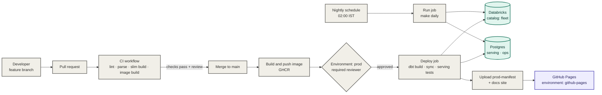

# Deployment

> **Project:** Fleet dbt Lakehouse (`<owner>/fleet-dbt-lakehouse`)
> **Status:** Design baseline · **Last updated:** 2026-11-16
> **Companion doc:** [ARCHITECTURE.md](ARCHITECTURE.md): what the system is and why.

This document explains **how the project is built, shipped and run**: the root `Dockerfile`, environments, GitHub Actions workflows, GitHub Deployments, and the GitHub Pages documentation site.

> **Version note.** Action versions, image tags and CLI flags below were current when this was written. Check each one against its upstream docs and pin to an exact version or commit SHA before relying on it.

---

## Table of contents

1. [Overview](#1-overview)
2. [Environments](#2-environments)
3. [GitHub setup](#3-github-setup)
4. [The root Dockerfile](#4-the-root-dockerfile)
5. [Configuration](#5-configuration)
6. [Makefile targets used by CI/CD](#6-makefile-targets-used-by-cicd)
7. [CI/CD workflows](#7-cicd-workflows)
8. [GitHub Pages documentation site](#8-github-pages-documentation-site)
9. [Running the pipeline in production](#9-running-the-pipeline-in-production)
10. [Source connectivity](#10-source-connectivity)
11. [Releases, versioning and rollback](#11-releases-versioning-and-rollback)
12. [Post-deploy verification](#12-post-deploy-verification)
13. [Monitoring and alerts](#13-monitoring-and-alerts)
14. [Troubleshooting](#14-troubleshooting)
15. [Cost controls](#15-cost-controls)

---

## 1. Overview

### 1.1 What is deployed where

| Artifact | Built by | Deployed to | Trigger |
|---|---|---|---|
| Project image (`Dockerfile`) | GitHub Actions | GitHub Container Registry (GHCR) | Every merge to `main`, every version tag |
| dbt models, snapshots, tests | `make deploy-prod` inside the image | Databricks (Unity Catalog `fleet`) | Merge to `main` (after approval) and the nightly schedule |
| Serving tables | Sync job and `dbt/serving` | Postgres `serving` and `ops` schemas | Same run as above |
| dbt documentation site | `dbt docs generate --static` | **GitHub Pages** | Merge to `main` |
| `manifest.json` (state for slim CI) | dbt | GitHub Actions artifact `prod-manifest` | Merge to `main` |
| Deployment history | GitHub Environments | **GitHub Deployments** tab | Every deploy job |

> **Important:** GitHub Pages is **static hosting**. It serves the documentation site only. It cannot run dbt, dlt or Dagster. The pipeline itself runs in Databricks and Postgres, started by GitHub Actions (or Dagster on a server). See [section 9](#9-running-the-pipeline-in-production).

### 1.2 Delivery flow



### 1.3 Two kinds of "deploy"

| | Code deploy | Data run |
|---|---|---|
| What changes | Models, macros, image version | Table contents |
| Workflow | `deploy.yml` | `nightly.yml` (or Dagster schedule) |
| Gated by | Required reviewer on `prod` environment | None (unattended) |
| Builds | Modified models only (state comparison) | Everything, incrementally |
| Updates docs | Yes | No |

---

## 2. Environments

| | Local | CI | Prod |
|---|---|---|---|
| Purpose | Development | Pull-request validation | Live platform |
| dbt target | `dev` | `ci` | `prod` |
| Databricks catalog | `fleet_dev` | `fleet_dev` | `fleet` |
| Schema pattern | `dev_<user>_<layer>` | `ci_pr_<n>_<layer>` | `<layer>` (exact) |
| Postgres | Docker (`docker-compose.yml`) | Service container in the job | Managed or self-hosted Postgres |
| Source data | Docker MySQL and MongoDB, or `csv` mode | `csv` mode (bundled snapshots) | `live` if reachable, otherwise `csv` |
| Databricks identity | Developer's own credentials or dev principal | `fleet-ci` service principal | `fleet-prod` service principal |
| Lifetime | Until dropped | Dropped when the PR closes | Permanent |

Schema names are produced by the `generate_schema_name` macro described in [ARCHITECTURE.md](ARCHITECTURE.md#15-environments-and-schema-naming).

---

## 3. GitHub setup

### 3.1 GitHub Environments

Create these under **Settings → Environments**. Each environment appears in the repository's **Deployments** view, which gives a history of what was deployed, when and by whom.

| Environment | Used by | Protection rules |
|---|---|---|
| `ci` | Pull-request workflow | None |
| `prod` | `deploy.yml` deploy job | **Required reviewers**; deployment branches limited to `main` and `v*` tags |
| `prod-run` | `nightly.yml` | **No required reviewers** (the run is unattended); same secrets as `prod`; branches limited to `main` |
| `github-pages` | Pages deploy job | Created automatically; restrict deployment branches to `main` |

> **Why two prod environments?** A required reviewer pauses every job that references the environment until someone approves. A nightly job would block forever. `prod` gates code releases; `prod-run` lets scheduled data runs proceed. Required-reviewer rules on private repositories depend on your GitHub plan.

### 3.2 Secrets and variables

Set them per environment (or at repository level when shared). **Variables** are not sensitive; **secrets** are.

| Name | Type | Environments | Used for |
|---|---|---|---|
| `DATABRICKS_HOST` | variable | ci, prod, prod-run | Workspace URL |
| `DATABRICKS_HTTP_PATH` | variable | ci, prod, prod-run | SQL warehouse HTTP path |
| `DATABRICKS_CLIENT_ID` | secret | ci, prod, prod-run | Service principal OAuth client id |
| `DATABRICKS_CLIENT_SECRET` | secret | ci, prod, prod-run | Service principal OAuth secret |
| `PG_HOST`, `PG_PORT`, `PG_DBNAME` | variable | prod, prod-run | Serving Postgres |
| `PG_USER`, `PG_PASSWORD` | secret | prod, prod-run | Serving Postgres writer role |
| `SOURCE_MODE` | variable | ci, prod, prod-run | `live` or `csv` |
| `MYSQL_HOST`, `MYSQL_USER`, `MYSQL_PASSWORD`, `MYSQL_DATABASE` | secret | prod-run (live mode) | Read-only MySQL access |
| `MONGO_URI` | secret | prod-run (live mode) | Read-only MongoDB access |
| `ALERT_WEBHOOK_URL` | secret | prod, prod-run | Failure notifications |

`GITHUB_TOKEN` is provided automatically and is used for GHCR and artifact access. No personal access token is required.

### 3.3 Databricks prerequisites

1. A Unity Catalog metastore with two catalogs: `fleet_dev` and `fleet`.
2. Two service principals, `fleet-ci` and `fleet-prod`, each with an OAuth secret.
3. A SQL warehouse (serverless where available) with auto-stop enabled.
4. Grants:
   - `fleet-ci`: `USE CATALOG`, `CREATE SCHEMA` and full rights on `fleet_dev`; **read-only** (`USE CATALOG`, `USE SCHEMA`, `SELECT`) on `fleet`. Read access to prod is needed so slim CI can **defer** to production models it did not rebuild.
   - `fleet-prod`: full rights on `fleet`; `CAN USE` on the SQL warehouse.

### 3.4 Branch protection for `main`

- Require a pull request and at least one approval.
- Require status checks: `lint`, `image-build`, `dbt-ci`.
- Require branches to be up to date before merging.
- Disallow force pushes.

### 3.5 Pages setting

**Settings → Pages → Build and deployment → Source: GitHub Actions.** See [section 8](#8-github-pages-documentation-site).

---

## 4. The root Dockerfile

One `Dockerfile` in the project root builds a single image that contains the whole project: dbt (both projects), dlt, Dagster, the sync job, the Makefile and all pinned Python dependencies. The same image runs locally, in CI and in production, so "works on my machine" and "works in prod" are the same statement.

### 4.1 Stages

| Stage | Based on | Purpose | Ships to prod? |
|---|---|---|---|
| `base` | `python:<ver>-slim-bookworm` | System packages and environment shared by all stages | Parent only |
| `builder` | `base` | Installs build tools and `uv`, resolves the locked dependency set into `/app/.venv`, runs `dbt deps` | No (build tools discarded) |
| `dev` | `builder` | Adds dev dependencies (ruff, sqlfluff, pytest, pre-commit) for local work and tests | No |
| `runtime` | `base` | Copies the finished `/app` from `builder`; runs as a non-root user | **Yes** (default target) |

`runtime` is the **last** stage, so a plain `docker build .` produces the production image.

### 4.2 Dockerfile

```dockerfile
# syntax=docker/dockerfile:1.7

ARG PYTHON_VERSION=3.12

# ---------------------------------------------------------------------------
# Stage 1: base. Shared foundation.
# ---------------------------------------------------------------------------
FROM python:${PYTHON_VERSION}-slim-bookworm AS base

ENV PYTHONUNBUFFERED=1 \
    PYTHONDONTWRITEBYTECODE=1 \
    PIP_DISABLE_PIP_VERSION_CHECK=1 \
    UV_LINK_MODE=copy \
    UV_COMPILE_BYTECODE=1 \
    UV_PYTHON_DOWNLOADS=never

# tini : proper PID 1 (signal handling, zombie reaping)
# git  : dbt packages that come from git
# make : every command in this project is a make target
# curl : health checks and debugging
# libpq5 : Postgres client library used at runtime
RUN apt-get update \
 && apt-get install -y --no-install-recommends \
        tini git make curl ca-certificates libpq5 \
 && rm -rf /var/lib/apt/lists/*

WORKDIR /app

# ---------------------------------------------------------------------------
# Stage 2: builder. Resolve and install dependencies, fetch dbt packages.
# ---------------------------------------------------------------------------
FROM base AS builder

# Pin to an exact uv version in real use (replace 'latest').
COPY --from=ghcr.io/astral-sh/uv:latest /uv /uvx /usr/local/bin/

RUN apt-get update \
 && apt-get install -y --no-install-recommends build-essential libpq-dev \
 && rm -rf /var/lib/apt/lists/*

# Dependency layer first: only invalidated when the lockfile changes.
COPY pyproject.toml uv.lock ./
RUN --mount=type=cache,target=/root/.cache/uv \
    uv sync --frozen --no-install-project --no-dev

# Project code, then install the project itself.
COPY . .
RUN --mount=type=cache,target=/root/.cache/uv \
    uv sync --frozen --no-dev

ENV PATH="/app/.venv/bin:${PATH}" \
    DBT_PROFILES_DIR=/app/dbt

# Install dbt packages at build time so runtime needs no package downloads.
RUN dbt deps --project-dir dbt/fleet \
 && dbt deps --project-dir dbt/serving

# ---------------------------------------------------------------------------
# Stage 3: dev. Adds developer tooling. Not used in production.
# ---------------------------------------------------------------------------
FROM builder AS dev

RUN --mount=type=cache,target=/root/.cache/uv \
    uv sync --frozen

CMD ["bash"]

# ---------------------------------------------------------------------------
# Stage 4: runtime. Slim, non-root production image. LAST stage = default.
# ---------------------------------------------------------------------------
FROM base AS runtime

ARG APP_UID=10001
ARG GIT_SHA=unknown
ARG BUILD_DATE=unknown

LABEL org.opencontainers.image.title="fleet-dbt-lakehouse" \
      org.opencontainers.image.source="https://github.com/<owner>/fleet-dbt-lakehouse" \
      org.opencontainers.image.revision="${GIT_SHA}" \
      org.opencontainers.image.created="${BUILD_DATE}"

RUN groupadd --gid ${APP_UID} app \
 && useradd  --uid ${APP_UID} --gid app --create-home --shell /usr/sbin/nologin app

COPY --from=builder --chown=app:app /app /app

ENV PATH="/app/.venv/bin:${PATH}" \
    DBT_PROFILES_DIR=/app/dbt \
    DAGSTER_HOME=/app/.dagster \
    GIT_SHA=${GIT_SHA}

RUN mkdir -p "${DAGSTER_HOME}" /app/out /app/prod-state \
 && chown -R app:app "${DAGSTER_HOME}" /app/out /app/prod-state

USER app
EXPOSE 3000

# No HEALTHCHECK here: the image also runs short batch jobs.
# The long-running Dagster webserver gets its health check in compose.
ENTRYPOINT ["/usr/bin/tini", "--"]
CMD ["make", "help"]
```

### 4.3 Design notes

| Choice | Reason |
|---|---|
| Multi-stage build | Compilers and headers stay in `builder`; the runtime image has only what it needs |
| Lockfile layer before code | Changing a model does not reinstall dependencies; rebuilds take seconds |
| BuildKit cache mount for `uv` | Repeated builds reuse downloaded wheels |
| `uv sync --frozen` | Fails if `uv.lock` is out of date, so the image can never drift from the lockfile |
| `dbt deps` at build time | No package downloads at runtime; reproducible package versions |
| `tini` as entrypoint | Correct signal handling so `docker stop` and CI cancellation shut down cleanly |
| Non-root user (`uid 10001`) | A compromised process cannot write to the system or bind privileged ports |
| No credentials in the image | Everything comes from environment variables at run time |
| `CMD ["make", "help"]` | Running the image with no arguments is safe and prints available targets |
| OCI labels and `GIT_SHA` | Every running container can be traced to the exact commit |

Expect the image to be several hundred megabytes, because dbt, Dagster and the Databricks connector are large. Check with `docker images` and watch for growth when adding dependencies.

### 4.4 `.dockerignore`

```gitignore
.git
.github
.venv
.env
.env.*
!.env.example
**/__pycache__
**/target
**/dbt_packages
**/logs
.pytest_cache
.ruff_cache
out
prod-state
docs
# Root-level markdown only. Docs blocks under dbt/ are .md files and must stay.
*.md
```

### 4.5 Building and running

```bash
# Production image (default target)
docker build \
  --build-arg GIT_SHA="$(git rev-parse HEAD)" \
  --build-arg BUILD_DATE="$(date -u +%Y-%m-%dT%H:%M:%SZ)" \
  -t fleet-dbt-lakehouse:local .

# Developer image with test and lint tools
docker build --target dev -t fleet-dbt-lakehouse:dev .

# Run any make target inside the image
docker run --rm --env-file .env fleet-dbt-lakehouse:local make build TARGET=dev
docker run --rm --env-file .env fleet-dbt-lakehouse:local make daily
```

### 4.6 Image tags

| Tag | Example | Meaning | Use |
|---|---|---|---|
| `sha-<commit>` | `sha-3f9c2e1…` | Exact commit | **Deploys always use this**: immutable and traceable |
| `<semver>` | `1.4.0` | Release tag | Rollbacks and releases |
| `latest` | `latest` | Newest `main` build | Convenience only; never deploy by `latest` |

### 4.7 Local stack (`docker-compose.yml`)

Starts the services needed for local development and the `live` source mode.

```yaml
services:
  mysql:
    image: mysql:8.4
    environment:
      MYSQL_ROOT_PASSWORD: ${MYSQL_ROOT_PASSWORD:-root}
      MYSQL_DATABASE: fleet_registry
    # Host port defaults to 13306: local mysqld often owns 3306 and Windows
    # excludes 3307-3406. Override with MYSQL_HOST_PORT.
    ports: ["${MYSQL_HOST_PORT:-13306}:3306"]
    volumes: ["mysql_data:/var/lib/mysql"]

  mongo:
    image: mongo:7
    ports: ["27017:27017"]
    volumes: ["mongo_data:/data/db"]

  postgres:
    image: postgres:16
    environment:
      POSTGRES_USER: ${PG_USER:-fleet}
      POSTGRES_PASSWORD: ${PG_PASSWORD:-fleet}
      POSTGRES_DB: ${PG_DBNAME:-fleet_serving}
    ports: ["5432:5432"]
    volumes: ["pg_data:/var/lib/postgresql/data"]
    healthcheck:
      test: ["CMD-SHELL", "pg_isready -U ${PG_USER:-fleet}"]
      interval: 10s
      retries: 5

  app:
    build:
      context: .
      target: dev
    env_file: .env
    depends_on:
      postgres: { condition: service_healthy }
    volumes:
      - .:/app           # live code reload for development
    command: ["sleep", "infinity"]

volumes:
  mysql_data:
  mongo_data:
  pg_data:
```

Start with `make up`, then `docker compose exec app make build`.

---

## 5. Configuration

### 5.1 `dbt/profiles.yml` (committed, contains no secrets)

```yaml
fleet:
  target: dev
  outputs:
    dev:
      type: databricks
      catalog: fleet_dev
      schema: "{{ env_var('DBT_DEV_SCHEMA', 'dev') }}"
      host: "{{ env_var('DATABRICKS_HOST') }}"
      http_path: "{{ env_var('DATABRICKS_HTTP_PATH') }}"
      auth_type: oauth
      client_id: "{{ env_var('DATABRICKS_CLIENT_ID') }}"
      client_secret: "{{ env_var('DATABRICKS_CLIENT_SECRET') }}"
      threads: 4
    ci:
      type: databricks
      catalog: fleet_dev
      schema: ci
      host: "{{ env_var('DATABRICKS_HOST') }}"
      http_path: "{{ env_var('DATABRICKS_HTTP_PATH') }}"
      auth_type: oauth
      client_id: "{{ env_var('DATABRICKS_CLIENT_ID') }}"
      client_secret: "{{ env_var('DATABRICKS_CLIENT_SECRET') }}"
      threads: 4
    prod:
      type: databricks
      catalog: fleet
      schema: default
      host: "{{ env_var('DATABRICKS_HOST') }}"
      http_path: "{{ env_var('DATABRICKS_HTTP_PATH') }}"
      auth_type: oauth
      client_id: "{{ env_var('DATABRICKS_CLIENT_ID') }}"
      client_secret: "{{ env_var('DATABRICKS_CLIENT_SECRET') }}"
      threads: 8

fleet_serving:
  target: dev
  outputs:
    dev: &pg
      type: postgres
      host: "{{ env_var('PG_HOST', 'localhost') }}"
      port: "{{ env_var('PG_PORT', '5432') | as_number }}"
      user: "{{ env_var('PG_USER') }}"
      password: "{{ env_var('PG_PASSWORD') }}"
      dbname: "{{ env_var('PG_DBNAME') }}"
      schema: serving
      threads: 4
    ci:   { <<: *pg }
    prod: { <<: *pg }
```

In `ci`, the `DBT_SCHEMA_PREFIX` variable (for example `ci_pr_42`) is applied by the `generate_schema_name` macro, so each pull request writes to its own schemas.

### 5.2 `.env.example`

```bash
# Databricks
DATABRICKS_HOST=https://<workspace>.cloud.databricks.com
DATABRICKS_HTTP_PATH=/sql/1.0/warehouses/<id>
DATABRICKS_CLIENT_ID=
DATABRICKS_CLIENT_SECRET=

# dbt
DBT_DEV_SCHEMA=dev_yourname
DBT_SCHEMA_PREFIX=dev_yourname

# Serving Postgres
PG_HOST=localhost
PG_PORT=5432
PG_USER=fleet
PG_PASSWORD=fleet
PG_DBNAME=fleet_serving

# Sources
SOURCE_MODE=live            # live | csv
MYSQL_HOST=localhost
MYSQL_USER=fleet_ro
MYSQL_PASSWORD=
MYSQL_DATABASE=fleet_registry
MONGO_URI=mongodb://localhost:27017/fleet_operations

# Dagster run storage (long-running mode only)
DAGSTER_PG_HOST=localhost
DAGSTER_PG_USER=dagster
DAGSTER_PG_PASSWORD=
DAGSTER_PG_DB=dagster
```

Copy to `.env` for local use. `.env` is git-ignored and excluded from the image.

---

## 6. Makefile targets used by CI/CD

`TARGET` selects the dbt target (`dev`, `ci` or `prod`). The same targets run on a laptop, in CI and in the image.

```make
SHELL      := /bin/bash
TARGET     ?= dev
STATE_DIR  := prod-state
OUT_DIR    := out
DBT_FLEET  := dbt --project-dir dbt/fleet   --profiles-dir dbt
DBT_SERVE  := dbt --project-dir dbt/serving --profiles-dir dbt

.PHONY: help setup up down deps parse build unit freshness ci-build \
        sync serve-build serve-test lint-fast lint-sql docs docs-static \
        daily weekly deploy-prod

help:            ## List targets
	@grep -E '^[a-zA-Z_-]+:.*## ' $(MAKEFILE_LIST) | sed 's/:.*## /\t/'

setup:           ## Install dependencies
	uv sync --frozen && pre-commit install

up:              ## Start local sources and Postgres
	docker compose up -d

down:            ## Stop local services
	docker compose down

deps:            ## Install dbt packages
	$(DBT_FLEET) deps && $(DBT_SERVE) deps

parse:           ## Validate the project without building
	$(DBT_FLEET) parse --target $(TARGET)

build:           ## dbt build (run + test + snapshot + seed)
	$(DBT_FLEET) build --target $(TARGET)

unit:            ## dbt unit tests only
	$(DBT_FLEET) test --select "test_type:unit" --target $(TARGET)

freshness:       ## Source freshness
	$(DBT_FLEET) source freshness --target $(TARGET)

ci-build:        ## Slim CI: build only what changed, defer the rest to prod
	@if [ -f $(STATE_DIR)/manifest.json ]; then \
	  echo "Slim CI against prod state"; \
	  $(DBT_FLEET) build --target ci --select "state:modified+" \
	      --defer --state $(STATE_DIR); \
	else \
	  echo "No prod state found: full CI build"; \
	  $(DBT_FLEET) build --target ci; \
	fi

sync:            ## Databricks -> Postgres (swap load, row-count check)
	python -m sync.run --env $(TARGET)

serve-build:     ## Build the Postgres serving project
	$(DBT_SERVE) build --target $(TARGET)

serve-test:      ## Serving parity tests
	$(DBT_SERVE) test --target $(TARGET)

lint-fast:       ## ruff, yamllint, gitleaks via pre-commit
	ruff check . && yamllint . && pre-commit run --all-files

lint-sql:        ## sqlfluff with the dbt templater (needs a profile)
	sqlfluff lint dbt/fleet/models dbt/serving/models

docs:            ## Local docs server
	$(DBT_FLEET) docs generate --target $(TARGET) && $(DBT_FLEET) docs serve

docs-static:     ## Single-file docs site for GitHub Pages
	$(DBT_FLEET) docs generate --target prod --static
	mkdir -p $(OUT_DIR)/site
	cp dbt/fleet/target/static_index.html $(OUT_DIR)/site/index.html

daily:           ## Full orchestrated run: ingest, build, sync, serve
	python -m orchestration.run --job daily_job

weekly:          ## Full refresh of incremental models
	python -m orchestration.run --job weekly_full_refresh_job

deploy-prod:     ## Used by deploy.yml inside the image
	mkdir -p $(OUT_DIR)
	$(MAKE) deps
	@if [ -f $(STATE_DIR)/manifest.json ]; then \
	  $(DBT_FLEET) build --target prod --select "state:modified+" --state $(STATE_DIR); \
	else \
	  $(DBT_FLEET) build --target prod; \
	fi
	$(MAKE) sync TARGET=prod
	$(MAKE) serve-build TARGET=prod
	$(MAKE) serve-test TARGET=prod
	$(MAKE) docs-static
	cp dbt/fleet/target/manifest.json $(OUT_DIR)/manifest.json
```

`python -m orchestration.run` is a thin wrapper around Dagster's job execution. The exact Dagster CLI command differs between Dagster versions, so keeping it behind `make daily` means workflows never change when it does.

---

## 7. CI/CD workflows

All workflows live in `.github/workflows/`.

### 7.1 `ci.yml`: pull-request validation

```yaml
name: CI

on:
  pull_request:
    branches: [main]

concurrency:
  group: ci-${{ github.event.pull_request.number }}
  cancel-in-progress: true

permissions:
  contents: read

jobs:
  lint:
    runs-on: ubuntu-latest
    steps:
      - uses: actions/checkout@v4
      - uses: astral-sh/setup-uv@v5
        with:
          enable-cache: true
      - run: uv sync --frozen
      - run: source .venv/bin/activate && make lint-fast

  image-build:
    runs-on: ubuntu-latest
    steps:
      - uses: actions/checkout@v4
      - uses: docker/setup-buildx-action@v3
      - uses: docker/build-push-action@v6
        with:
          context: .
          target: runtime
          push: false
          cache-from: type=gha
          cache-to: type=gha,mode=max

  dbt-ci:
    needs: lint
    runs-on: ubuntu-latest
    environment: ci
    timeout-minutes: 30
    permissions:
      contents: read
      actions: read            # to download the prod manifest artifact
    services:
      postgres:
        image: postgres:16
        env:
          POSTGRES_USER: fleet
          POSTGRES_PASSWORD: fleet
          POSTGRES_DB: fleet_serving
        ports: ["5432:5432"]
        options: >-
          --health-cmd "pg_isready -U fleet"
          --health-interval 10s
          --health-retries 5
    env:
      DATABRICKS_HOST: ${{ vars.DATABRICKS_HOST }}
      DATABRICKS_HTTP_PATH: ${{ vars.DATABRICKS_HTTP_PATH }}
      DATABRICKS_CLIENT_ID: ${{ secrets.DATABRICKS_CLIENT_ID }}
      DATABRICKS_CLIENT_SECRET: ${{ secrets.DATABRICKS_CLIENT_SECRET }}
      DBT_SCHEMA_PREFIX: ci_pr_${{ github.event.number }}
      SOURCE_MODE: ${{ vars.SOURCE_MODE }}
      PG_HOST: localhost
      PG_PORT: "5432"
      PG_USER: fleet
      PG_PASSWORD: fleet
      PG_DBNAME: fleet_serving
      GH_TOKEN: ${{ github.token }}
    steps:
      - uses: actions/checkout@v4
      - uses: astral-sh/setup-uv@v5
        with:
          enable-cache: true
      - run: uv sync --frozen

      - name: Fetch prod manifest for slim CI
        run: |
          mkdir -p prod-state
          RUN_ID=$(gh run list --repo "$GITHUB_REPOSITORY" --workflow deploy.yml \
                   --branch main --status success --limit 1 \
                   --json databaseId --jq '.[0].databaseId // empty')
          if [ -n "$RUN_ID" ]; then
            gh run download "$RUN_ID" --repo "$GITHUB_REPOSITORY" \
               --name prod-manifest --dir prod-state \
               || echo "No manifest available; falling back to a full build"
          fi

      - name: Install dbt packages and validate
        run: |
          source .venv/bin/activate
          make deps
          make parse TARGET=ci
          make lint-sql

      - name: Slim CI build (run + test + unit tests)
        run: source .venv/bin/activate && make ci-build

      - name: Test the sync and serving layer
        run: |
          source .venv/bin/activate
          make sync TARGET=ci
          make serve-build TARGET=ci
          make serve-test TARGET=ci
```

Notes:

- **Slim CI** builds only models that changed (`state:modified+`) and **defers** unchanged upstream models to production. This is why `fleet-ci` needs read access to the `fleet` catalog.
- If no prod manifest exists (first PR, or the artifact expired after its retention period), the build falls back to a full run.
- Pull requests from **forks do not receive secrets**, so `dbt-ci` will not run for them. Maintainers can re-push the branch inside the repository.
- `make lint-sql` runs in `dbt-ci` because the sqlfluff dbt templater needs a working profile.

### 7.2 `cleanup-ci.yml`: drop PR schemas

```yaml
name: Cleanup CI schemas

on:
  pull_request:
    types: [closed]

permissions:
  contents: read

jobs:
  drop-schemas:
    runs-on: ubuntu-latest
    environment: ci
    env:
      DATABRICKS_HOST: ${{ vars.DATABRICKS_HOST }}
      DATABRICKS_HTTP_PATH: ${{ vars.DATABRICKS_HTTP_PATH }}
      DATABRICKS_CLIENT_ID: ${{ secrets.DATABRICKS_CLIENT_ID }}
      DATABRICKS_CLIENT_SECRET: ${{ secrets.DATABRICKS_CLIENT_SECRET }}
    steps:
      - uses: actions/checkout@v4
      - uses: astral-sh/setup-uv@v5
      - run: uv sync --frozen
      - name: Drop this PR's schemas
        run: |
          source .venv/bin/activate
          dbt run-operation drop_ci_schemas \
            --project-dir dbt/fleet --profiles-dir dbt --target ci \
            --args "{prefix: ci_pr_${{ github.event.number }}}"
```

The macro refuses to drop anything that does not start with `ci_pr_`:

```sql

  
    {{ exceptions.raise_compiler_error('Refusing to drop schemas without a ci_pr_ prefix') }}
  
  
  
    
      
    
  

```

### 7.3 `deploy.yml`: build image, deploy to prod, publish docs

```yaml
name: Deploy

on:
  push:
    branches: [main]
    tags: ["v*.*.*"]
  workflow_dispatch:        # re-run from a tag in the UI to roll back

permissions:
  contents: read

concurrency:
  group: deploy-prod
  cancel-in-progress: false  # never cancel a deploy halfway

jobs:
  image:
    name: Build and push image
    runs-on: ubuntu-latest
    permissions:
      contents: read
      packages: write
    outputs:
      image: ${{ steps.vars.outputs.image }}
      ref: ${{ steps.vars.outputs.ref }}
    steps:
      - uses: actions/checkout@v4

      - name: Compute lowercase image name
        id: vars
        run: |
          IMAGE="ghcr.io/${GITHUB_REPOSITORY,,}"
          echo "image=${IMAGE}" >> "$GITHUB_OUTPUT"
          echo "ref=${IMAGE}:sha-${GITHUB_SHA}" >> "$GITHUB_OUTPUT"

      - uses: docker/setup-buildx-action@v3

      - uses: docker/login-action@v3
        with:
          registry: ghcr.io
          username: ${{ github.actor }}
          password: ${{ secrets.GITHUB_TOKEN }}

      - id: meta
        uses: docker/metadata-action@v5
        with:
          images: ${{ steps.vars.outputs.image }}
          tags: |
            type=sha,format=long
            type=semver,pattern={{version}}
            type=raw,value=latest,enable={{is_default_branch}}

      - uses: docker/build-push-action@v6
        with:
          context: .
          target: runtime
          push: true
          tags: ${{ steps.meta.outputs.tags }}
          labels: ${{ steps.meta.outputs.labels }}
          build-args: |
            GIT_SHA=${{ github.sha }}
            BUILD_DATE=${{ github.event.head_commit.timestamp }}
          cache-from: type=gha
          cache-to: type=gha,mode=max

  deploy:
    name: Deploy to prod
    needs: image
    runs-on: ubuntu-latest
    environment: prod           # required reviewer gate + Deployments history
    timeout-minutes: 45
    permissions:
      contents: read
      packages: read
      actions: read
    steps:
      - uses: docker/login-action@v3
        with:
          registry: ghcr.io
          username: ${{ github.actor }}
          password: ${{ secrets.GITHUB_TOKEN }}

      - name: Fetch previous prod manifest
        env:
          GH_TOKEN: ${{ github.token }}
        run: |
          mkdir -p prod-state out
          RUN_ID=$(gh run list --repo "$GITHUB_REPOSITORY" --workflow deploy.yml \
                   --branch main --status success --limit 1 \
                   --json databaseId --jq '.[0].databaseId // empty')
          if [ -n "$RUN_ID" ]; then
            gh run download "$RUN_ID" --repo "$GITHUB_REPOSITORY" \
               --name prod-manifest --dir prod-state \
               || echo "No previous manifest; running a full build"
          fi
          # the container runs as uid 10001, so the mounted dirs must be writable
          chmod -R a+rwX prod-state out

      - name: Build, sync, test and generate docs inside the image
        env:
          IMAGE_REF: ${{ needs.image.outputs.ref }}
          DATABRICKS_HOST: ${{ vars.DATABRICKS_HOST }}
          DATABRICKS_HTTP_PATH: ${{ vars.DATABRICKS_HTTP_PATH }}
          DATABRICKS_CLIENT_ID: ${{ secrets.DATABRICKS_CLIENT_ID }}
          DATABRICKS_CLIENT_SECRET: ${{ secrets.DATABRICKS_CLIENT_SECRET }}
          PG_HOST: ${{ vars.PG_HOST }}
          PG_PORT: ${{ vars.PG_PORT }}
          PG_DBNAME: ${{ vars.PG_DBNAME }}
          PG_USER: ${{ secrets.PG_USER }}
          PG_PASSWORD: ${{ secrets.PG_PASSWORD }}
        run: |
          docker run --rm \
            -e DATABRICKS_HOST -e DATABRICKS_HTTP_PATH \
            -e DATABRICKS_CLIENT_ID -e DATABRICKS_CLIENT_SECRET \
            -e PG_HOST -e PG_PORT -e PG_DBNAME -e PG_USER -e PG_PASSWORD \
            -v "$PWD/prod-state:/app/prod-state" \
            -v "$PWD/out:/app/out" \
            "$IMAGE_REF" make deploy-prod

      - name: Save manifest for the next slim CI run
        uses: actions/upload-artifact@v4
        with:
          name: prod-manifest
          path: out/manifest.json
          retention-days: 90

      - name: Package docs site for GitHub Pages
        uses: actions/upload-pages-artifact@v3
        with:
          path: out/site

  pages:
    name: Publish docs to GitHub Pages
    needs: deploy
    runs-on: ubuntu-latest
    permissions:
      pages: write
      id-token: write
    environment:
      name: github-pages
      url: ${{ steps.deployment.outputs.page_url }}
    steps:
      - id: deployment
        uses: actions/deploy-pages@v4
```

How the pieces connect:

1. `image` builds once and tags the image with the exact commit. The deploy job runs **that commit's image**, so the code that was reviewed is the code that runs.
2. `deploy` pauses for the `prod` environment reviewer, then runs `make deploy-prod` inside the image. Credentials are passed as environment variables and never written to disk.
3. `deploy` uploads two artifacts: the manifest (for the next slim CI run) and the docs site (for Pages).
4. `pages` publishes the docs. It is a separate job because Pages deployments need their own permissions and environment.

### 7.4 What shows up in GitHub Deployments

Each job that references an environment creates a deployment record. After a release you will see:

| Environment | Record shows |
|---|---|
| `prod` | Commit, actor, approver, time, status of the data deploy |
| `github-pages` | Commit and the live docs URL |
| `ci` | One entry per pull-request validation |

This is a lightweight audit trail of every release, with no extra tooling.

---

## 8. GitHub Pages documentation site

### 8.1 What is hosted

The site is the **dbt documentation**: model and column descriptions, lineage graph from source to dashboard exposure, tests, and compiled SQL. It is generated as a single static file (`dbt docs generate --static`), so no server is needed.

Optional additions: the Elementary data-observability report (`edr report`) and the rendered `ARCHITECTURE.md` and `DEPLOYMENT.md`, placed under extra paths inside `out/site/`.

### 8.2 One-time setup

1. **Settings → Pages → Build and deployment → Source:** choose **GitHub Actions**.
2. **Settings → Environments → `github-pages`:** restrict deployment branches to `main`.
3. Run the **Deploy** workflow once (merge to `main` or use **Run workflow**).
4. The URL appears on the deployment record and is typically `https://<owner>.github.io/<repo>/`.

### 8.3 Why generation runs inside the deploy job

`dbt docs generate` queries the warehouse for column types and row statistics, so it needs production credentials. Those exist in the `prod` environment, so docs are generated inside `make deploy-prod` and only the finished static site is handed to the Pages job. The Pages job itself has **no warehouse credentials**.

If you prefer to avoid warehouse access during docs generation, use `dbt docs generate --empty-catalog`. The trade-off is that column data types and statistics will be missing from the site.

### 8.4 Required workflow permissions

| Permission | Job | Why |
|---|---|---|
| `pages: write` | `pages` | Allows deploying to Pages |
| `id-token: write` | `pages` | Lets the deploy action verify the source of the deployment |
| `contents: read` | all | Check out code |

### 8.5 Things to know

- A Pages site is **public by default** for public repositories. Private visibility for Pages depends on your GitHub plan.
- The site exposes model SQL and column names. That is fine for this synthetic dataset; review before publishing anything sensitive.
- Only one Pages deployment is live at a time; each deploy replaces the previous one.
- Pull requests do not publish docs. If you want PR previews, upload the site as a workflow artifact instead.

---

## 9. Running the pipeline in production

Pages and the deploy workflow ship **code and docs**. The pipeline that moves data also needs a runtime. Two options are supported; both run the same image and the same `make daily`.

| | Option A: scheduled GitHub Actions | Option B: long-running Dagster |
|---|---|---|
| Where it runs | GitHub-hosted runner, one container per run | A VM or container host you manage |
| Scheduler | `schedule` in `nightly.yml` | Dagster daemon |
| Always-on cost | None | Server cost |
| Dagster UI | No (CLI execution only) | Yes (asset graph, run history) |
| Run history | GitHub Actions logs | Dagster UI and Postgres run storage |
| Best for | Portfolio and low-cost setups | Realistic operations |
| Caveat | GitHub cron is best-effort and can start minutes late | You operate and patch the host |

### 9.1 Option A: `nightly.yml`

```yaml
name: Nightly run

on:
  schedule:
    - cron: "30 20 * * *"     # 20:30 UTC = 02:00 IST
  workflow_dispatch:

permissions:
  contents: read
  packages: read

concurrency:
  group: nightly-run
  cancel-in-progress: false

jobs:
  daily:
    runs-on: ubuntu-latest
    environment: prod-run          # no required reviewers
    timeout-minutes: 60
    steps:
      - uses: docker/login-action@v3
        with:
          registry: ghcr.io
          username: ${{ github.actor }}
          password: ${{ secrets.GITHUB_TOKEN }}

      - name: Run the daily job
        env:
          DATABRICKS_HOST: ${{ vars.DATABRICKS_HOST }}
          DATABRICKS_HTTP_PATH: ${{ vars.DATABRICKS_HTTP_PATH }}
          DATABRICKS_CLIENT_ID: ${{ secrets.DATABRICKS_CLIENT_ID }}
          DATABRICKS_CLIENT_SECRET: ${{ secrets.DATABRICKS_CLIENT_SECRET }}
          PG_HOST: ${{ vars.PG_HOST }}
          PG_PORT: ${{ vars.PG_PORT }}
          PG_DBNAME: ${{ vars.PG_DBNAME }}
          PG_USER: ${{ secrets.PG_USER }}
          PG_PASSWORD: ${{ secrets.PG_PASSWORD }}
          SOURCE_MODE: ${{ vars.SOURCE_MODE }}
          MYSQL_HOST: ${{ secrets.MYSQL_HOST }}
          MYSQL_USER: ${{ secrets.MYSQL_USER }}
          MYSQL_PASSWORD: ${{ secrets.MYSQL_PASSWORD }}
          MYSQL_DATABASE: ${{ secrets.MYSQL_DATABASE }}
          MONGO_URI: ${{ secrets.MONGO_URI }}
        run: |
          IMAGE="ghcr.io/${GITHUB_REPOSITORY,,}:latest"
          docker run --rm \
            -e DATABRICKS_HOST -e DATABRICKS_HTTP_PATH \
            -e DATABRICKS_CLIENT_ID -e DATABRICKS_CLIENT_SECRET \
            -e PG_HOST -e PG_PORT -e PG_DBNAME -e PG_USER -e PG_PASSWORD \
            -e SOURCE_MODE -e MYSQL_HOST -e MYSQL_USER -e MYSQL_PASSWORD \
            -e MYSQL_DATABASE -e MONGO_URI \
            "$IMAGE" make daily
```

The data run uses `latest` (the newest merged code); code deploys always use an immutable `sha-` tag.

### 9.2 Option B: `docker-compose.prod.yml` on a server

```yaml
services:
  dagster-postgres:
    image: postgres:16
    environment:
      POSTGRES_USER: ${DAGSTER_PG_USER}
      POSTGRES_PASSWORD: ${DAGSTER_PG_PASSWORD}
      POSTGRES_DB: ${DAGSTER_PG_DB}
    volumes: ["dagster_pg:/var/lib/postgresql/data"]
    restart: unless-stopped

  dagster-webserver:
    image: ${IMAGE_REF}
    command: ["dagster-webserver", "-h", "0.0.0.0", "-p", "3000", "-m", "orchestration.definitions"]
    env_file: .env.prod
    ports: ["3000:3000"]
    depends_on: [dagster-postgres]
    healthcheck:
      test: ["CMD", "curl", "-fsS", "http://localhost:3000/server_info"]
      interval: 30s
      timeout: 5s
      retries: 3
    restart: unless-stopped

  dagster-daemon:
    image: ${IMAGE_REF}
    command: ["dagster-daemon", "run", "-m", "orchestration.definitions"]
    env_file: .env.prod
    depends_on: [dagster-postgres]
    restart: unless-stopped

volumes:
  dagster_pg:
```

`dagster.yaml` in `DAGSTER_HOME` points run storage at Postgres:

```yaml
storage:
  postgres:
    postgres_db:
      username: { env: DAGSTER_PG_USER }
      password: { env: DAGSTER_PG_PASSWORD }
      hostname: { env: DAGSTER_PG_HOST }
      db_name:  { env: DAGSTER_PG_DB }
      port: 5432
```

To deploy a release on the server:

```bash
export IMAGE_REF=ghcr.io/<owner>/fleet-dbt-lakehouse:sha-<commit>
docker compose -f docker-compose.prod.yml pull
docker compose -f docker-compose.prod.yml up -d
```

The webserver and daemon always run the **same image tag**, so schedules and the UI never disagree about code.

### 9.3 Optional: Databricks-native job

A Databricks Asset Bundle in `databricks/` can define a Databricks job that runs the dbt project with Databricks' native dbt task, as a fallback runner independent of GitHub or Dagster. It is not part of the default path, to avoid having two schedulers.

---

## 10. Source connectivity

**GitHub-hosted runners can only reach systems that are exposed to the internet.** They cannot reach `localhost`, your laptop, or a private network. Every system the pipeline touches must be reachable from where it runs.

| System | Reachable from a GitHub-hosted runner? | What to do |
|---|---|---|
| Databricks | Yes (cloud service) | Use OAuth service principals |
| Postgres (serving) | Only if it has a public endpoint | Use a managed Postgres with SSL and a restricted role, or run the sync from a self-hosted runner |
| MySQL and MongoDB sources | Not if they run in local Docker | Choose one of the modes below |

### 10.1 Source modes

| Mode | `SOURCE_MODE` | How it works | Best for |
|---|---|---|---|
| Live (cloud) | `live` | Sources hosted in the cloud (for example a managed MySQL and MongoDB free tier); dlt connects directly | Realistic end-to-end runs |
| Snapshot | `csv` | Gzipped CSV exports committed under `data/raw/` are loaded as if they were the sources | CI and public demos with no source access |
| Live (local) | `live` + self-hosted runner | A runner on your own machine or network reaches local Docker sources | Local-only setups |

Use `csv` mode in CI so pull requests are reproducible and never depend on external databases.

---

## 11. Releases, versioning and rollback

### 11.1 Versioning

- Semantic versioning: `vMAJOR.MINOR.PATCH`.
  - MAJOR: breaking change to mart schemas (contract change).
  - MINOR: new models or marts.
  - PATCH: fixes with no schema change.
- Keep a `CHANGELOG.md`.

### 11.2 Cutting a release

```bash
git checkout main && git pull
git tag -a v1.2.0 -m "Release 1.2.0"
git push origin v1.2.0
```

The tag triggers `deploy.yml`, which builds the image tagged `1.2.0` and `sha-<commit>`, then waits for `prod` approval.

### 11.3 Rolling back

| Scenario | Action |
|---|---|
| A bad **code** release | In **Actions → Deploy → Run workflow**, choose the previous tag as the ref. The image for that commit is built or reused and redeployed. |
| Bad data in a mart (Databricks) | Delta time travel: `RESTORE TABLE fleet.marts.<table> TO VERSION AS OF <n>`; find versions with `DESCRIBE HISTORY` |
| Bad data in `serving` (Postgres) | The previous table is kept as `<table>__prev` until the next sync; swap the names back in one transaction |
| Incremental model corrupted | `dbt build --select <model> --full-refresh --target prod` |
| Docs wrong | Re-run Deploy; each run replaces the Pages site |

> After a rollback, re-run the data job. A `state:modified+` deploy only rebuilds models that differ from the saved manifest, so the manifest from the rolled-back release is the correct baseline.

---

## 12. Post-deploy verification

After every release, confirm:

- [ ] The `prod` deployment shows a green status in the **Deployments** view.
- [ ] The docs URL loads and shows the new model or column.
- [ ] In Databricks, `audit_dbt_runs` has a new row with zero failed tests.
- [ ] `audit_reconciliation` shows expected row counts matching actuals.
- [ ] Source freshness is within threshold (`make freshness TARGET=prod`).
- [ ] In Postgres, `ops.pipeline_status` shows a recent success time.
- [ ] Row counts match between `marts.<table>` and `serving.<table>` for synced tables.
- [ ] The BI dashboard loads and shows today's data.

---

## 13. Monitoring and alerts

| Signal | Where | Alert |
|---|---|---|
| Workflow failure | GitHub Actions | GitHub notifications; optional webhook step on `failure()` |
| Data-run failure | Dagster failure sensor (Option B) or the nightly workflow (Option A) | `ALERT_WEBHOOK_URL` message |
| Test failures | `audit_test_failures`, Elementary report | Run fails; message includes failing test names |
| Stale sources | `dbt source freshness` | Warn at 26h, error at 48h |
| Volume anomalies | Elementary anomaly tests on large tables | Warning in the report |
| Sync mismatch | Row-count check in sync job | Run fails |

Example failure notification step for any workflow:

```yaml
      - name: Notify on failure
        if: failure()
        run: |
          curl -fsS -X POST -H 'Content-Type: application/json' \
            -d "{\"text\":\"${GITHUB_WORKFLOW} failed on ${GITHUB_REF_NAME} (${GITHUB_SERVER_URL}/${GITHUB_REPOSITORY}/actions/runs/${GITHUB_RUN_ID})\"}" \
            "${{ secrets.ALERT_WEBHOOK_URL }}"
```

---

## 14. Troubleshooting

| Symptom | Likely cause | Fix |
|---|---|---|
| Pages URL returns 404 | Pages source is not set to GitHub Actions, or the deploy job did not run | Settings → Pages → Source: GitHub Actions; re-run Deploy |
| `pages` job: permission error | Missing `pages: write` or `id-token: write` on that job | Add both under the job's `permissions` |
| `upload-pages-artifact` finds nothing | `out/site/index.html` was not created | Check `make docs-static` output; confirm the volume mount and `chmod` step |
| GHCR push denied | Missing `packages: write`, or the image name has uppercase letters | Add the permission; use the lowercase-name step |
| Deploy job waits forever | `prod` environment requires a reviewer | Approve in the Actions run, or use `prod-run` for unattended jobs |
| Container cannot write to `out/` | Container runs as uid 10001 and the mounted folder is not writable | `chmod -R a+rwX out prod-state` before `docker run` |
| Slim CI runs a full build | No prod manifest (first PR, or artifact retention expired) | Expected; it self-heals after the next successful deploy |
| `--defer` fails with permission denied | CI principal lacks read access on catalog `fleet` | Grant `USE CATALOG`, `USE SCHEMA`, `SELECT` on `fleet` to `fleet-ci` |
| CI schemas pile up | Cleanup workflow did not run or failed | Re-run `cleanup-ci.yml`; check the `ci_pr_` prefix guard |
| `dbt deps` fails in the container build | Network or package-hub rate limit | Re-run the build; pin package versions in `packages.yml` |
| Sync fails to connect to Postgres | Server not reachable from the runner | Use a public managed Postgres with SSL, or a self-hosted runner |
| Nightly job starts late or is skipped | GitHub cron is best-effort | Accept delay, or move to Option B |
| Schema collision between developers | `DBT_SCHEMA_PREFIX` not set | Set a per-developer prefix in `.env` |
| `dbt docs generate` is slow or fails | Warehouse stopped or cold | Warm the SQL warehouse first, or use `--empty-catalog` |

---

## 15. Cost controls

| Lever | Setting |
|---|---|
| SQL warehouse | Smallest size that finishes in time; **auto-stop after 5 to 10 minutes** |
| CI | Slim CI builds only changed models; `concurrency` cancels superseded runs |
| CI schemas | Dropped automatically on PR close |
| Schedule | One full run per day; weekly full refresh instead of daily |
| Actions minutes | BuildKit and `uv` caching; `timeout-minutes` on every job |
| Docs | Generated once per deploy, not per PR |
| Postgres | Small instance; only small mart tables are synced |
| Image | Rebuilt only when code or the lockfile changes |
