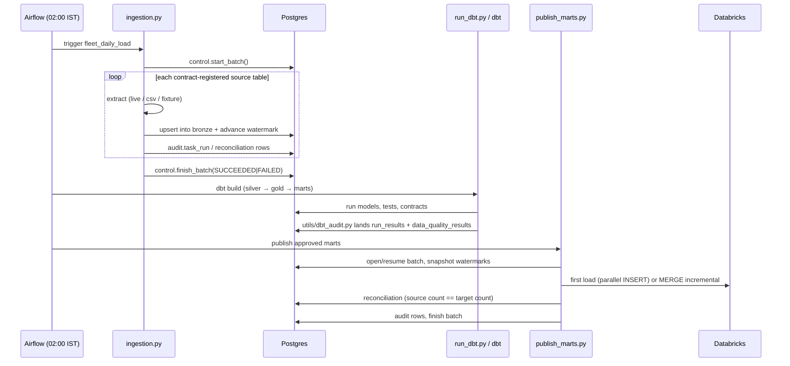
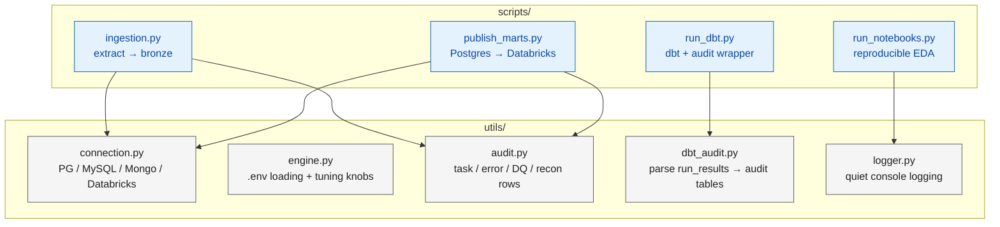
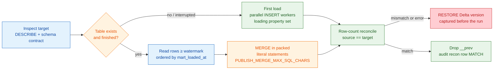
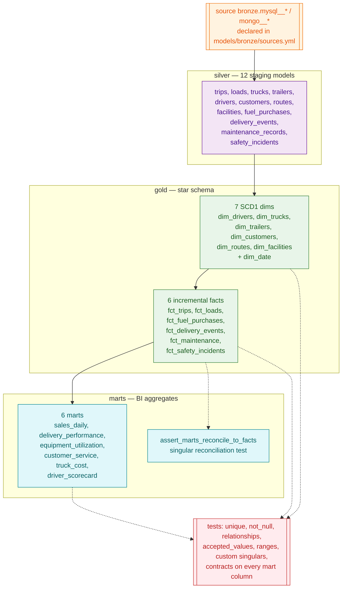
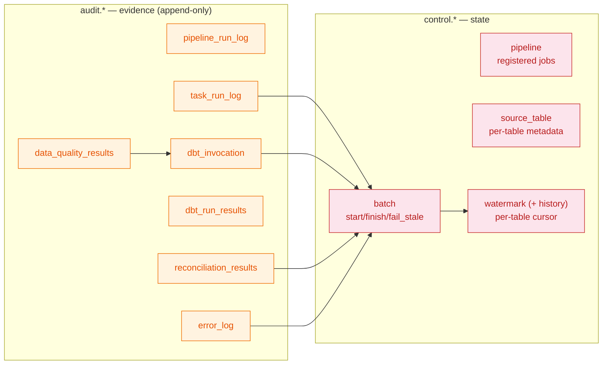
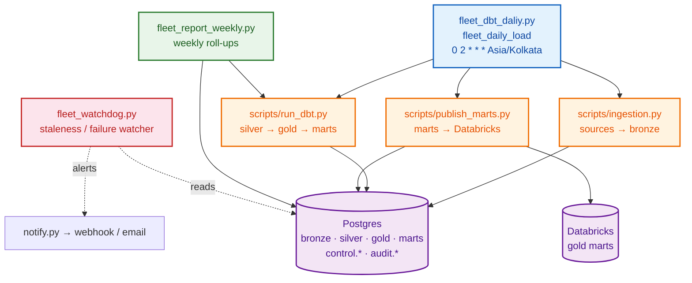
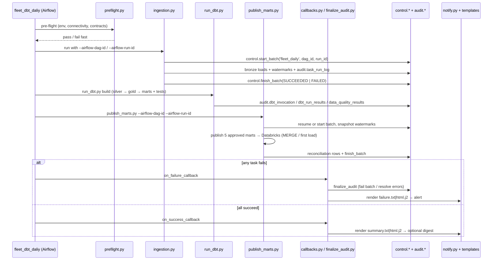
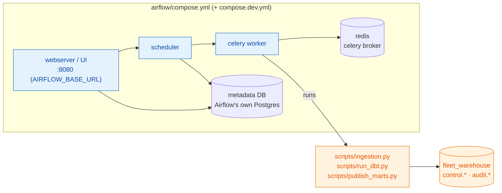

# PROJECT.md — Fleet dbt Warehouse

## What we are doing

A daily analytics warehouse for fleet operations. Operational data lives in two
source systems — **MySQL** (`fleet_registry`: drivers, trucks, loads, trips, …)
and **MongoDB** (`fleet_operations`: delivery events, maintenance, safety). We
land that data in **Postgres**, transform it with **dbt** through clean layered
models, publish approved marts to **Databricks** for BI, and record every step
in an audit/control plane so any run can be explained, retried or rolled back.

**In one line:** MySQL + MongoDB → dlt-style ingestion → Postgres bronze →
dbt (silver → gold → marts) → sync to Databricks marts, orchestrated daily,
contract-guarded and fully audited.

---

## Project tree

```text
fleets/
├── AGENTS.md                  # rules for AI agents working in this repo
├── CHANGELOG.md               # release history (contract changes logged here)
├── CLAUDE.md                  # Claude-specific notes
├── Makefile                   # single entry point: make help lists all targets
├── pyproject.toml             # Python deps (uv-managed)
├── uv.lock                    # locked dependency graph (committed)
├── .env.example               # every config knob, placeholders only
│
├── contracts/                 # source-of-truth schemas for every landing table
│   ├── sources/               #   12 YAML contracts (mysql__*, mongo__*)
│   ├── samples/               #   sample JSON payloads per source
│   └── sources_index.json     #   contract index used by contracts-check
│
├── scripts/                   # runnable pipeline steps (Python)
│   ├── ingestion.py           #   MySQL + MongoDB → bronze, watermarks, audit
│   ├── run_dbt.py             #   invokes dbt, lands run results in audit.*
│   ├── publish_marts.py       #   approved Postgres marts → Databricks
│   └── run_notebooks.py       #   reproducible notebook runner
│
├── utils/                     # shared plumbing imported by every script
│   ├── engine.py              #   loads .env once, exposes all config knobs
│   ├── connection.py          #   PG / MySQL / Mongo / Databricks connections
│   ├── audit.py               #   task, error, DQ and reconciliation audit rows
│   ├── dbt_audit.py           #   dbt artifacts → audit.dbt_* tables
│   └── logger.py              #   quiet-console file logger
│
├── dbt/                       # the dbt project (transformation owner)
│   ├── dbt_project.yml        #   schemas, vars (lookbacks, dim_date range)
│   ├── profiles.yml           #   fleet_dbt → Postgres targets (dev/ci/prod)
│   ├── packages.yml           #   dbt package deps
│   ├── models/
│   │   ├── bronze/sources.yml #   source declarations (bronze.*)
│   │   ├── silver/            #   12 staging models + schema.yml
│   │   ├── gold/              #   7 dims + dim_date + 6 facts + schema.yml
│   │   └── marts/             #   6 marts + reconcile assertion + schema.yml
│   ├── macros/                #   cleaning, gold_helpers, marts_helpers, …
│   └── tests/
│       └── generic/silver/    #   11 generic tests (ranges, text, null-rate…)
│
├── sql/scripts/               # bootstrap applied by `make db-init` (in order)
│   ├── 01_init_schema.sql     #   bronze/silver/gold/marts/audit/control schemas
│   ├── 02_audit_tables.sql    #   append-only audit.* tables
│   ├── 03_control_pipeline_registry.sql
│   ├── 04_control_batch_tracking.sql
│   ├── 05_control_watermarks.sql
│   ├── 06_audit_relationships.sql
│   └── 07_pipeline_event_triggers.sql  #  failure audit + pg_notify alert
│
├── notebooks/                 # EDA notebooks (mysql_eda, mongo_eda)
├── docs/                      # design notes (FINDING.md)
├── tests/                     # pytest suite (unit / contract / smoke)
│   ├── conftest.py
│   ├── test_ingestion.py
│   ├── test_publish_marts.py
│   ├── test_dbt_audit.py
│   ├── test_audit.py
│   ├── test_connection.py
│   ├── test_engine.py
│   ├── test_makefile.py
│   └── test_run_notebooks.py
│
└── .githooks/                 # commit-msg + pre-push (contract checks)
```

Generated / not committed: `.venv/`, `dbt/target/`, `dbt/logs/`, `dbt_packages/`,
`logs/`, `out/`, `__pycache__/`, `.env`.

---

## End-to-end data flow

```mermaid
flowchart LR
    classDef src fill:#e3f2fd,stroke:#1565c0,stroke-width:2px,color:#0d47a1
    classDef bronze fill:#fff3e0,stroke:#ef6c00,stroke-width:2px,color:#e65100
    classDef silver fill:#f3e5f5,stroke:#6a1b9a,stroke-width:2px,color:#4a148c
    classDef gold fill:#e8f5e9,stroke:#2e7d32,stroke-width:2px,color:#1b5e20
    classDef mart fill:#e0f7fa,stroke:#00838f,stroke-width:2px,color:#006064
    classDef bi fill:#fff8e1,stroke:#f9a825,stroke-width:2px,color:#f57f17
    classDef ctrl fill:#fce4ec,stroke:#c62828,stroke-width:2px,color:#b71c1c

    subgraph sources["Source systems (read-only)"]
        MYSQL[("MySQL<br/>fleet_registry")]
        MONGO[("MongoDB<br/>fleet_operations")]
    end

    subgraph ingest["scripts/ingestion.py"]
        ING[Extract → cast → watermark<br/>contract-checked loads]
    end

    subgraph pg["Postgres fleet_warehouse"]
        BRONZE[("bronze<br/>raw landing tables")]
        SILVER[("silver<br/>cleaned, deduped,<br/>typed entities")]
        GOLD[("gold<br/>dims + facts<br/>star schema")]
        MARTS[("marts<br/>denormalised<br/>BI marts")]
    end

    subgraph dbt_layer["dbt (scripts/run_dbt.py)"]
        DBT[["silver → gold → marts<br/>tests + contracts + docs"]]
    end

    subgraph dbrx["Databricks"]
        PUBLISH[("gold marts copy<br/>Delta tables")]
        BI[BI / dashboards]
    end

    CTRL[("control.*<br/>batches, watermarks,<br/>pipeline registry")]
    AUDIT[("audit.*<br/>runs, tasks, dbt results,<br/>DQ, reconciliation, errors")]

    MYSQL --> ING
    MONGO --> ING
    ING --> BRONZE
    BRONZE --> DBT
    DBT --> SILVER
    SILVER --> GOLD
    GOLD --> MARTS
    DBT -.runs.-> DBT
    MARTS -->|scripts/publish_marts.py| PUBLISH
    PUBLISH --> BI

    ING -.writes.-> AUDIT
    DBT -.results.-> AUDIT
    PUBLISH -.reconcile.-> AUDIT
    ING -.watermarks.-> CTRL

    class MYSQL,MONGO src
    class BRONZE bronze
    class SILVER silver
    class GOLD gold
    class MARTS mart
    class PUBLISH,BI bi
    class CTRL,AUDIT ctrl
```



### Layer colours

| Colour | Layer | Written by | Meaning |
|---|---|---|---|
| 🟠 orange | `bronze` | `scripts/ingestion.py` only | Raw landing; immutable history of what arrived |
| 🟣 purple | `silver` | dbt only | One model per source table: dedupe, cast, validate |
| 🟢 green | `gold` | dbt only | Star schema: 7 SCD1 dims + `dim_date` + 6 facts |
| 🔵 teal | `marts` | dbt only | Denormalised, ratio-safe BI aggregates |
| 🔵 cyan | Databricks marts | `scripts/publish_marts.py` only | Synced copy of approved marts for BI |
| 🔴 pink | `control` / `audit` | Python + SQL functions | Run metadata, watermarks, evidence |

---

## Daily run, step by step



Everything is **idempotent**: dlt/Postgres upserts, dbt `delete+insert`
incrementals, MERGE on the Databricks side, and resumable batches mean a
re-run with the same inputs converges to the same state.

---

## The scripts



### `scripts/ingestion.py` — source → bronze

- Reads every contract in `contracts/sources/*.yml` (one per source table).
- Three source modes: `live` (MySQL/Mongo), `csv`, `fixture` — same code path.
- Casts MySQL types to Postgres (`_MYSQL_TO_PG`), lands into `bronze.mysql__*`
  / `bronze.mongo__*` with `_ingested_at` bookkeeping columns.
- Incremental via `control.watermark` (cursor column, e.g. `updated_at` or
  `_ingested_at`); advances only after a successful load
  (`control.advance_watermark`, regression-guarded).
- Registers itself in `control.pipeline` / `control.source_table`, opens a
  `control.batch`, and writes `audit.task_run_log` + reconciliation rows.
- Failure path: `audit.log_error`, batch failed, watermark untouched.

### `scripts/run_dbt.py` — dbt + audit wrapper

- Loads `.env`, invokes `dbt` from `dbt/` with whatever CLI args you passed.
- After the run (success or failure), `utils/dbt_audit.py` parses
  `dbt/target/run_results.json` and the manifest and lands:
  - `audit.dbt_invocation` — one row per dbt call (command, target, timing, exit code)
  - `audit.dbt_run_results` — per-model status / rows / timing
  - `audit.data_quality_results` — per-test status (the DQ evidence)
- Best-effort: an audit failure never masks dbt's own exit code.

### `scripts/publish_marts.py` — Postgres marts → Databricks

Publishes only the **approved non-PII** marts:

```
mart_sales_daily
mart_equipment_utilization_daily
mart_delivery_performance_daily
mart_customer_service_monthly
mart_truck_cost_monthly
```

`mart_driver_scorecard_monthly` (driver display names) is deliberately **never**
published — it stays in Postgres.

Per mart:



Safety properties:

- **Schema contract** checked before any write (drift → abort).
- **Delta version** captured before the run; any failure/count-mismatch
  `RESTORE`s to it, so a half-finished run never leaves a torn table.
- **First load** marks the table with a `loading` property until counts
  reconcile; an interrupted first load is detected and redone next run.
- **Row counts** must match `marts.<mart>` exactly or the run fails and rolls back.
- **Audit**: one `audit.reconciliation_results` row per successful mart, plus
  task/error rows; marts publish in parallel threads but audit writes stay on
  the main thread.

### `scripts/run_notebooks.py`

Executes the EDA notebooks under `notebooks/` into `out/notebooks/` so notebook
runs are reproducible from the CLI / CI.

### `utils/` — shared plumbing

| Module | Role |
|---|---|
| `engine.py` | Loads `.env` once; exposes every config knob (PG/MySQL/Mongo/Databricks, publish tuning, retry policy) |
| `connection.py` | Lazy engines/connections: Postgres, MySQL (session TZ), Mongo, Databricks (`open_databricks_connection` with retry/backoff) |
| `audit.py` | Context-managed task rows, error/DQ/reconciliation writers; closes audit rows even on `BaseException` |
| `dbt_audit.py` | Turns dbt artifacts into `audit.dbt_invocation`, `audit.dbt_run_results`, `audit.data_quality_results` |
| `logger.py` | `get_logger()` — file logging, quiet console |

---

## How dbt works here



### Layer rules (the contract)

| Layer | Materialisation | Rules |
|---|---|---|
| **silver** | `incremental`, `delete+insert`, `unique_key=<entity>_id` | One model per source table. Only: rename, cast, dedupe (latest by `_ingested_at`), validate ranges/enums, derive fields (MPG, idle share). Incremental window: `bronze_incremental_filter()` (lookback var). |
| **gold dims** | `table` (SCD1 overwrite) | Conformed keys via `gold_key()` / `gold_date_key()`, `dim_hash` for change detection, PII hashed/masked (`gold_hash_pii`, `gold_mask_tail`). |
| **gold facts** | `incremental`, `delete+insert` | Grain documented in each file. Recompute a row when the entity **or its parent** moved (`silver_loaded_at` / `gold_watermark()`). Additive measures summed; ratios never averaged naively. |
| **marts** | `incremental`, `delete+insert`, `unique_key=mart_key` | Denormalised facts + dims. Affected-group re-aggregation: recompute a grain when its fact rows changed **or** a joined dim attribute hash changed (`mart_hash`). Ratios via `mart_ratio()` (guard against zero denominators). |

### Key macros (`dbt/macros/`)

| Macro | Job |
|---|---|
| `bronze_incremental_filter()` | `WHERE _ingested_at > now() - lookback` for silver incrementals |
| `clean_string/date/timestamp/boolean` | Normalise dirty source text/dates/flags |
| `gold_key`, `gold_date_key`, `gold_unknown_key` | Surrogate keys; NULL → `unknown` key |
| `gold_hash_pii`, `gold_mask_tail` | Salted SHA-256 hash; mask to last-N (PII never leaves Postgres raw) |
| `gold_watermark()`, `mart_watermark()` | Incremental cut-off from the model's own loaded-at column |
| `mart_key`, `mart_hash`, `mart_ratio`, `mart_month_key` | Composite keys, dim-change detection, safe ratios |
| `generate_schema_name` | Routes models into `silver` / `gold` / `marts` schemas |

### dbt project layout

```
dbt/
├── dbt_project.yml      # schemas, vars (lookbacks, dim_date range)
├── profiles.yml         # fleet_dbt → Postgres (dev/ci/prod targets)
├── models/
│   ├── bronze/sources.yml   # source declarations (bronze.*)
│   ├── silver/              # 12 staging models + schema.yml
│   ├── gold/                # 7 dims + dim_date + 6 facts + schema.yml
│   └── marts/               # 6 marts + reconcile assertion + schema.yml
├── macros/               # cleaning, gold_helpers, marts_helpers, …
└── tests/                # custom singular tests
```

### dbt quality gates

- **Column contracts**: every gold/mart column has `description` + `data_type`.
- **Tests**: PK `unique`+`not_null`, FK `relationships`, `accepted_values`,
  `non_negative`, `within_range`, `not_in_future`, `is_clean_text`, `is_us_state_code`.
- **Singular**: `assert_marts_reconcile_to_facts` proves marts roll up from facts.
- **`on_schema_change: append_new_columns`** on incrementals; silent drift is a
  test failure, not a surprise.

---

## Control & audit plane



- **`control.*`** is the mutable state: which pipelines exist, which batch is
  running, where each source's watermark sits (with history + regression guard).
- **`audit.*`** is append-only evidence: every task, dbt invocation, test
  result, reconciliation and error, linked to its `batch_id`.
- Bootstrap: `make db-init` runs `sql/scripts/01..07` in order. Task failures and
  batch failures are mirrored into `audit.error_log` by triggers; batch failures
  also publish `pg_notify('pipeline_failure', json)`.

---

## Where things run

| Concern | Choice |
|---|---|
| Orchestration | Airflow daily `0 2 * * *` (`Asia/Kolkata`); scripts accept `--airflow-dag-id/--airflow-run-id` so batches tie back to DAG runs. Local runs use synthetic ids. |
| Entrypoint | `Makefile` — `make help` lists every target (`ingest`, `dbt-build`, `publish-marts`, `verify`, …) |
| Config | `.env` only (see `.env.example`); never hard-coded hosts/credentials |
| Contracts | `contracts/sources/*.yml` ↔ dbt `sources.yml`; `make contracts-check` fails on drift |
| CI | lint (ruff) → unit tests → dbt parse/compile → smoke → image build |
| Money | `decimal` / `numeric` only — never float |
| PII | Hashed or masked in silver/gold; raw values stop at Postgres staging; publish list excludes PII marts |

---

## Quick reference

```bash
make help                # all targets
make verify              # lint + unit tests (local gate)
make db-init             # create schemas + control/audit functions
make ingest              # sources → bronze
make dbt-build           # silver → gold → marts (+ tests)
make publish-marts       # approved marts → Databricks
make contracts-check     # source contract drift gate
```

Layer ownership (who may write where):

| Layer | Written only by |
|---|---|
| `bronze` | `scripts/ingestion.py` |
| `silver`, `gold`, `marts` | dbt |
| `control`, `audit` | Python (`utils/audit.py`) + SQL functions |
| Databricks marts | `scripts/publish_marts.py` |


# AIRFLOW.md — Orchestration tree

Airflow owns **when** the pipeline runs; the repo scripts own **what** runs.
Airflow never transforms data itself — every task shells out to a script under
`scripts/` (or `make`), and those scripts write their own `control.*` /
`audit.*` rows so a DAG run and a warehouse batch always tie back together.

- Schedule (daily): `0 2 * * *` **Asia/Kolkata** (= `30 20 * * *` UTC)
- Pipeline name in `control.pipeline`: `fleet_daily`
- Ingestion DAG id: `fleet_daily_load` (`scripts/ingestion.py`)
- Publish DAG id: passed via `--airflow-dag-id` (`scripts/publish_marts.py`,
  local fallback `publish_marts_local`)

---

## Directory tree

```text
airflow/
├── README                          # Airflow-specific readme (stub)
├── Dockerfile                      # apache/airflow:<ver>-python3.13 base image
├── compose.yml                     # production-ish compose stack
├── compose.dev.yml                 # local dev overrides
├── requirments-airflow.txt         # providers: fab, celery, standard, redis
├── requirments-dev.txt             # pytest, ruff, jinja2, psycopg2, pendulum, airflow==3.3.2
├── .gitignore
│
├── dags/                           # ← the DAG files (what runs, in what order)
│   ├── fleet_dbt_daliy.py          # daily: ingest → dbt → publish  (0 2 * * *)
│   ├── fleet_report_weekly.py      # weekly reporting roll-up DAG
│   └── fleet_watchdog.py           # watchdog: stale batches, failed runs, alerts
│
├── helpers/
│   ├── scripts/                    # shared Python used by the DAGs
│   │   ├── prefilght.py            # pre-flight checks (env, connectivity)
│   │   ├── commads.py              # command builders for scripts/* invocations
│   │   ├── callbacks.py            # success / failure task callbacks
│   │   ├── notify.py               # alert dispatch (webhook / email)
│   │   ├── summary.py              # run-summary builder for notifications
│   │   ├── auidt_reader.py         # read control/audit state into the DAG context
│   │   ├── finalize_audit.py       # close batches / tasks from Airflow callbacks
│   │   └── redact.py               # strip secrets/PII before logging or notifying
│   │
│   └── template/                   # Jinja2 notification templates
│       ├── summary.txt.j2          # plain-text success summary
│       ├── summary.html.j2         # HTML success summary
│       ├── failure.txt.j2          # plain-text failure report
│       └── failure.html.j2         # HTML failure report
│
└── scripts/                        # container / entrypoint shell scripts
    ├── entrypoint.sh               # image entrypoint (init then start)
    ├── init.sh                     # first-run init (db, users, fernet key)
    └── healthcheck_worker.sh       # worker health probe
```

> **Status:** the runtime files (Dockerfile, compose files, and shell scripts)
> are implemented. DAGs, helpers, templates, and their tests are implemented
> alongside their respective orchestration components.

---

## The three DAGs



| DAG file | DAG id (planned) | Schedule | Role |
|---|---|---|---|
| `dags/fleet_dbt_daliy.py` | `fleet_daily_load` | `0 2 * * *` Asia/Kolkata | Main pipeline: ingest → dbt build → publish marts |
| `dags/fleet_report_weekly.py` | weekly report | weekly cron | Re-run selected marts / build the weekly report payload |
| `dags/fleet_watchdog.py` | watchdog | frequent (e.g. every 15 min) | Detect stale `control.batch` rows, failed runs, watermark regressions; fire notifications |

---

## Daily DAG task flow



### Task dependencies (intended)

```text
preflight
    └──► ingest_bronze          (scripts/ingestion.py)
              └──► dbt_build    (scripts/run_dbt.py build)
                        └──► publish_marts   (scripts/publish_marts.py)
                                  └──► notify_summary
```

- **Serial by design:** each stage only makes sense on the previous stage's
  output (bronze before dbt, dbt before publish).
- Every task passes `--airflow-dag-id {{ dag.dag_id }}` and
  `--airflow-run-id {{ run_id }}` so `control.batch.airflow_*` columns match
  the Airflow UI.

---

## Helpers & templates

| Helper | Used by | Purpose |
|---|---|---|
| `prefilght.py` | DAG setup | Fail fast if `.env` vars, DB connectivity or contracts are missing |
| `commads.py` | task builders | Construct the exact `uv run … scripts/<x>.py` argv for each task |
| `callbacks.py` | task callbacks | Wrap success/failure hooks; call `finalize_audit` + `notify` |
| `finalize_audit.py` | failure/success path | `control.finish_batch`, resolve open `audit.error_log` rows |
| `auidt_reader.py` | watchdog / summaries | Query `control.batch`, `audit.task_run_log` for current run state |
| `summary.py` | notify | Build the context dict rendered by the Jinja templates |
| `notify.py` | notify | Send via `ALERT_WEBHOOK_URL` / email; never logs secrets |
| `redact.py` | all log/notify paths | Strip tokens, passwords, PII salt before anything leaves the process |

Templates (`helpers/template/`): `summary.{txt,html}.j2` for green runs,
`failure.{txt,html}.j2` for red runs — rendered by `summary.py` and sent by
`notify.py`.

---

## Container stack



- **Image:** `Dockerfile` — `apache/airflow:${AIRFLOW_VERSION}-python3.13`,
  labelled with the git SHA for traceability.
- **Providers** (`requirments-airflow.txt`): fab, celery, standard, redis.
- **Dev tools** (`requirments-dev.txt`): pytest, ruff, jinja2, psycopg2-binary,
  pendulum, `apache-airflow==3.3.2`.
- **Config from `.env`:** `AIRFLOW_HOST`, `AIRFLOW_PORT`, `AIRFLOW_BASE_URL`,
  admin user fields, `AIRFLOW__CORE__FERNET_KEY` (generate with
  `Fernet.generate_key()` — never commit it).
- **Shell scripts:** `init.sh` (first-run), `entrypoint.sh` (boot),
  `healthcheck_worker.sh` (probe).

---

## How a DAG run ties back to the warehouse

```text
Airflow run                          Postgres
───────────                          ────────
dag_id  ──────────────────────────►  control.batch.airflow_dag_id
run_id  ──────────────────────────►  control.batch.airflow_run_id
logical_date ─────────────────────►  control.batch.logical_date

task start  ──────────────────────►  audit.task_run_log (RUNNING)
task end    ──────────────────────►  audit.task_run_log (SUCCEEDED | FAILED)
any error   ──────────────────────►  audit.error_log
dbt done    ──────────────────────►  audit.dbt_invocation + dbt_run_results
                                    + data_quality_results
batch end   ──────────────────────►  control.finish_batch(status, message)
```

Rules:

- Airflow **never** writes `bronze` / `silver` / `gold` / `marts` — only the
  scripts do.
- A failed task must close its batch (`finalize_audit.py` in the failure
  callback); `control.fail_stale_batches` is the safety net for crashed workers.
- Retry only transient errors; contract or data-test failures are permanent
  until the data/logic is fixed.
- Notifications go through `redact.py` first — no tokens, no PII salt, no row
  values in alert text.

---

## Quick reference

```bash
# local stack (from repo root, once compose files are filled in)
docker compose --env-file .env -f airflow/compose.yml -f airflow/compose.dev.yml up -d

# what the daily DAG actually invokes (same as manual runs)
uv run python scripts/ingestion.py
uv run python scripts/run_dbt.py build --target dev
uv run python scripts/publish_marts.py --airflow-dag-id fleet_daily_load
```

See `PROJECT.md` for the full end-to-end data flow and `Makefile` (`make help`)
for every supported entry point.
